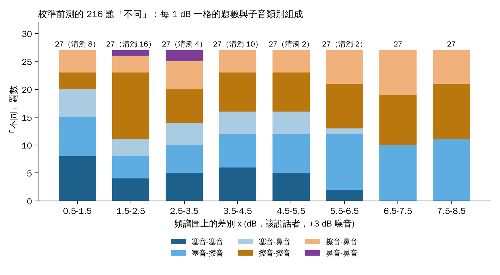

# 線上「聲音校準前測」試作（jsPsych 7，Pavlovia）

子音同 / 異判斷，**單一 SNR（現行版本 +3 dB）**，216 題不同 + 108 題相同，題目依「頻譜圖上的差別」均勻鋪開。
目的：看一位受試者做一場，能不能定出他自己的 L（曲線中點附近）與 H（到頂點）。
這是提案的試作（`review/evaluation_2026-11-24_current_vs_proposed_sound_scale.md` §7 第 1 步），不是實驗的一部分；實驗主程式沒有因它改動。

## 版本

| | 第 1 版 | 第 2 版（這個資料夾現在的內容） |
|---|---|---|
| SNR | +6 dB | **+3 dB**（和 SFT 實驗同一個值，`DECISIONS.md` 第 27 條） |
| 產生日期（`conditions.json` 的 `built`） | 2026-11-25 | 2026-11-26 |
| 做過的人 | CAL01（`review/pilot_2026-11-26_CAL01_calib_pilot.md`：對他偏簡單，八格裡六格在天花板） | 還沒有人 |
| 重新產生 | `python online/make_calib_pilot_stimuli.py --snr 6 --out <別的資料夾>`（`conditions.json` 逐位元相同，已驗證） | `python online/make_calib_pilot_stimuli.py`（預設） |
| 資料檔怎麼分辨 | `snr_db` 欄 = 6 | `snr_db` 欄 = 3 |

兩版之間**只改了 SNR**（`online/make_calib_pilot_stimuli.py:52`）：分格、填格規則、`PLAN_SEED`、頁面程式（`index.html`、`experiment.js`）都相同。
但題目清單不一樣：噪音多了，每個音檔對的 x 都變小，落進每一格的是另一批音檔對。噪音種子只跟題號有關（`:184`），所以兩版同一題號的種子相同。
要換到 Pavlovia 上的檔案只有 7 個：`conditions.json` 和 `bundles/stim_p1.json`–`stim_p6.json`；`bundles/stim_hp.json`（耳機檢查）沒有變。
轉檔程式兩版都能讀（它從資料檔拿題目內容，只用 `conditions.json` 核對種子）。

## 與 `online/snr_pilot/` 的差別

| | `snr_pilot/`（WEB01 用的，保持原樣） | `calib_pilot/`（這裡） |
|---|---|---|
| SNR | 0 / +6 / +12 dB 三段，各 108 題 | 只有一個（現行 +3 dB，見上表），324 題（`online/make_calib_pilot_stimuli.py:52-54`） |
| 題目的軸 | d′ 表的六個層級 | 頻譜圖差別，每 1 dB 一格、0.5–8.5 dB 共 8 格（`:55`） |
| 題目的單位 | 子音對，說話者隨機 | 子音對 × 說話者；x 用該說話者兩個音檔的值 |
| 只差清濁的對子 | 碰巧抽到（WEB01 只有 f–v 3 題） | 7 對全放，每對 6 題（`:65`、`:129-135`） |
| 說話者 | 12 個編號隨機 | 三組聲音之間平衡，組別記進資料（`:62`） |
| 題目順序 | 三段各自洗牌，種子沒記 | 整場洗一次，`order_seed` 記進資料，可重建（`experiment.js:21`、`:48`） |
| 開頭 | 只有網址帶的受試者編號 | 不問任何問題。編號來自網址；沒帶或是 `test` 這類佔位字，就用當下的日期時間產生一個（`experiment.js:60`）。母語等背景由研究者另外記錄 |
| 噪音種子 | 數字（被瀏覽器四捨五入過） | 字串（`make_calib_pilot_stimuli.py:184`、`experiment.js:164`） |

試次的時間結構、按鍵（Y 相同 / N 不同）、回饋、耳機檢查都沿用。

## 題目組成（第 2 版，+3 dB；程式產生的實際結果，`design.csv`、`design.png`）

「不同」216 題。x = 該說話者在 +3 dB 的頻譜圖差別（算法同 `analyze/acoustic_scale_compute.py` 的 `ex_T??` 欄，+3 dB 的表存在 `analyze/out/acoustic_scale_pairs_snr3.csv`），範圍 0.82–8.40 dB，105 個不同的子音對。

| x (dB) | 題數 | 其中清濁對 | 不同的對 | 塞–塞 | 塞–擦 | 塞–鼻 | 擦–擦 | 擦–鼻 | 鼻–鼻 | G1 / G2 / G3 | 最常出現的子音 | 含 ʃ 的比例 |
|---|---|---|---|---|---|---|---|---|---|---|---|---|
| 0.5–1.5 | 27 | 8 | 19 | 8 | 7 | 5 | 3 | 4 | 0 | 10 / 10 / 7 | b 10、p 9、m 8 | 0 |
| 1.5–2.5 | 27 | 16 | 14 | 4 | 4 | 3 | 12 | 3 | 1 | 10 / 9 / 8 | θ 9、ð 8、f 7 | 0 |
| 2.5–3.5 | 27 | 4 | 24 | 5 | 5 | 4 | 6 | 5 | 2 | 10 / 8 / 9 | n 8、z 7、d 6 | .07 |
| 3.5–4.5 | 27 | 10 | 20 | 6 | 6 | 4 | 7 | 4 | 0 | 9 / 9 / 9 | t 10、z 9、ʒ 6 | .15 |
| 4.5–5.5 | 27 | 2 | 21 | 5 | 7 | 4 | 7 | 4 | 0 | 10 / 9 / 8 | t 11、ʒ 11、z 5 | 0 |
| 5.5–6.5 | 27 | 2 | 23 | 2 | 10 | 1 | 8 | 6 | 0 | 9 / 9 / 9 | s 14、ʒ 9、t 6 | 0 |
| 6.5–7.5 | 27 | 0 | 18 | 0 | 10 | 0 | 9 | 8 | 0 | 15 / 0 / 12 | ʃ 18、s 9、m 4 | .67 |
| 7.5–8.5 | 27 | 0 | 11 | 0 | 11 | 0 | 10 | 6 | 0 | 0 / 0 / 27 | ʃ 27、ð 3、g 3 | 1.00 |



- **均勻鋪開**：8 格各 27 題。清濁對先放進去（落在哪一格由它們的 x 決定），其餘用「補到一樣高」的方式填（`make_calib_pilot_stimuli.py:137-161`）。
- **清濁對**（每對 6 題 = 三組聲音 × 兩個方向，共 42 題）：g–k 0.85–1.68、b–p 1.02–1.28、f–v 1.53–1.56、ð–θ 1.54–1.97、s–z 2.93–4.61、ʃ–ʒ 3.23–4.09、d–t 3.74–5.53 dB。d′ 表給它們的值是 2.88–4.58（表上算容易）。
- **三組聲音**：G1（T01–T06）73 題、G2（T07–T09）54 題、G3（T10–T12）89 題，比第 1 版（80 / 68 / 68）不平均。
- **+3 dB 讓高的那一端材料變少**（這是第 2 版比第 1 版差的地方）：
  - 全部 1440 個音檔對裡，x 落在 7.5–8.5 dB 的只有 30 個（+6 dB 時 89 個）、6.5–7.5 dB 的 78 個（+6 dB 時 170 個）。
  - 最高一格 27 題**全部含 /ʃ/、全部來自 G3**，只有 11 個不同的對；6.5–7.5 dB 那格 67% 含 /ʃ/、沒有 G2。第 1 版最高一格是 59% 含 /ʃ/、三組各約 9 題。
  - 所以在最高兩格，「x 大」和「含 /ʃ/、是 G3 的聲音」分不開。CAL01 在 +6 dB 時 2.5 dB 以上全在天花板，如果 +3 dB 也是這樣，這兩格只用來估到頂的高度，影響不大；如果有人在這兩格答錯很多，就無法分辨是 x 還是 /ʃ/ 或說話者造成的。
- **其他做不到的地方**：
  - 6.5 dB 以上沒有塞–塞的對，也沒有塞–鼻：材料裡差別這麼大的對一定含擦音。
  - 最低一格以 b、p、m 為主；1.5–2.5 dB 那格擦–擦偏多（12 題），因為清濁對有 16 題落在這裡。
  - 中間四格（2.5–6.5 dB）六種類別大致平均。這是材料的限制，抽樣只能緩和、不能消除。
- 「相同」108 題：16 個子音 × 三組聲音 × 2 = 96 題，另 12 題分給 12 個不同的子音、每組聲音 4 題（`:164-172`）。兩個音節是同一個音檔配不同的噪音。

第 1 版（+6 dB）的組成表在這個檔案的 git 歷史裡（提交 `b341bf6` 的版本），或用上面的指令重新產生 `design.csv`。

## 檔案

```
online/calib_pilot/                 上傳這個資料夾裡的 15 個檔（每個 < 5 MB）
   index.html、experiment.js        實驗本體
   conditions.json                  固定的 324 題：對子、說話者、組別、x、種子、檔名
   js/（5 個檔）                    jsPsych 與三個 plugin、css（與 snr_pilot 相同的檔）
   bundles/（7 個檔）               聲音：stim_hp.json（耳機檢查）、stim_p1..p6.json（各 54 題的兩個音節，約 4 MB）
   design.csv、design.png           題目組成（不用上傳）
   stim/                            產生 bundles 用的 666 個 wav（不用上傳；不進 git）
online/make_calib_pilot_stimuli.py  產生 stim/、conditions.json、design.*（固定的 PLAN_SEED，結果可重現）
online/pack_stimuli.py calib_pilot  stim/ → bundles/
online/pavlovia_to_perception_csv.py   資料檔 → data/<id>_sound_perception_dprime_snr6.csv + .json
online/calib_pilot_browser_test.js  用無頭瀏覽器把整場跑一遍的測試程式（不用上傳）
online/calib_pilot_failure_test.js  檔案壞掉時頁面會怎樣：六種損壞各跑一次（不用上傳）
online/check_pavlovia_deploy.py     上傳後的驗證：把 Pavlovia 上的 15 個檔和這個資料夾逐一比對
online/calib_pilot/MANIFEST.sha256  15 個檔的 SHA-256 與大小（不用上傳）；改過任何一個檔後用 --write-manifest 重寫
```

重新產生（結果應與 repo 裡的相同）：

```bash
python analyze/acoustic_scale_compute.py          # 產生 analyze/out/acoustic_scale_pairs.csv（約 25 秒）
python online/make_calib_pilot_stimuli.py
python online/pack_stimuli.py calib_pilot
```

## 放上 Pavlovia

**檔案一律「上傳」或用 git 推，不要用貼上文字的方式建立。** 2026-11-26 的事故就是這樣來的（見下一節）。

1. pavlovia.org → Dashboard → **Experiments** → New：選 *jsPsych*，取名。Pavlovia 會建一個 GitLab repo。
2. 把 15 個檔放上去，兩種做法擇一：
   - **用 git（建議，一次全部、不會截斷）**。在有這個 repo 的電腦上：
     ```bash
     git clone https://gitlab.pavlovia.org/<帳號>/<實驗名>.git pav     # 會問 Pavlovia 的帳號密碼
     cd pav
     cp ../Visual_AudioWM/online/calib_pilot/{index.html,experiment.js,conditions.json} .
     mkdir -p js bundles
     cp ../Visual_AudioWM/online/calib_pilot/js/* js/
     cp ../Visual_AudioWM/online/calib_pilot/bundles/stim_*.json bundles/
     git add . && git commit -m "calibration pilot" && git push
     ```
   - **用 GitLab 網頁**：在 gitlab.pavlovia.org 打開那個 repo，`+` → **Upload file**，選電腦上的檔案。
     要換掉已經存在的檔：點進那個檔 → **Replace** → 選檔案 → *Replace file*。
     根目錄 3 個（`index.html`、`experiment.js`、`conditions.json`）；`+` → *New directory* 建 `js` 放 5 個；建 `bundles` 放 7 個（`stim_hp.json`、`stim_p1.json` … `stim_p6.json`）。
     **不要用 `+` → New file 再把內容貼進去**，也不要在終端機的編輯器裡貼：`js/jspsych.js` 是一行九萬多字的檔，貼上會被截斷。
   - 路徑必須正好是 `js/...` 和 `bundles/...`。**不要建 `lib/`**：Pavlovia 保留這個名字，有它就會拒絕同步。
3. **驗證（每次上傳後都做）**：
   ```bash
   python online/check_pavlovia_deploy.py <帳號> <實驗名>
   ```
   它把 Pavlovia 上的 15 個檔逐一下載，和這個資料夾比大小與 SHA-256（`online/check_pavlovia_deploy.py:124-135`）。全部 `OK`、最後一行是 `15 of 15 files identical.` 才算好。
   不一致時會說是哪一種：被截斷（部署的是本機檔的前 N 位元組）、只有縮排不同（貼進會自動縮排的編輯器）、或內容不同（舊版）。
   手邊沒有 Python 時，下載回來的資料夾可以用 `sha256sum -c MANIFEST.sha256` 檢查。
4. 實驗狀態設成 **Piloting** 可以免費試跑；**Running** 才能正式收（要點數或授權）。
5. 給受試者的連結：`https://run.pavlovia.org/<帳號>/<實驗名>/?participant=CAL01`
   - 編號只從 `participant=` 來，頁面不會問受試者任何問題。不帶、或帶的是 `test`、`anon` 這類佔位字（`experiment.js:23`），頁面會自己產生 `P年月日_時分秒` 當編號，資料的 `id_source` 欄寫 `generated`。
   - **母語等背景頁面不記錄**，請在發連結時自己記下「編號 ↔ 是誰、母語是什麼」。
   - 測試用：`&skipcheck=1` 跳過耳機檢查；`&maxtrials=12` 只跑前 12 題；`&order_seed=數字` 固定題目順序。
6. 資料：Dashboard → 該實驗 → Download results，每位受試者一個 CSV。

Pavlovia 的橋接程式沿用 `snr_pilot` 的寫法（`index.html` 載入 `https://lib.pavlovia.org/jspsych-7-pavlovia-2022.1.1.js`）；WEB01 那一場用它存到了資料。

## 2026-11-26 的事故：`js/jspsych.js` 在 Pavlovia 上只有前 20000 位元組

第一位受試者用連結打不開，回報 `js/jspsych.js` 不完整；他在本機把那個檔換成完整的 jsPsych 7.3.4 才跑完。

**量到的**（`python online/check_pavlovia_deploy.py`，2026-11-26，對當時的 repo 版）：

| 檔 | Pavlovia 上 | repo | 差在哪 |
|---|---|---|---|
| `js/jspsych.js` | 20000 位元組 | 98520 | 部署的是 repo 檔的前 20000 位元組，一個位元組都不差，然後就沒了 |
| `index.html` | 2276 | 1349 | 文字相同，每一行比上一行多縮排（共 30 行，最深 68 格） |
| `experiment.js` | 49030 | 11618 | 文字相同（就是沒有開頭表單的那一版），每一行比上一行多縮排（共 154 行，最深 826 格） |
| 其餘 12 個（`conditions.json`、css、三個 plugin、七個 bundle） | | | 逐位元相同 |

- 瀏覽器裡的直接原因：`js/jspsych.js` 讀到一半結束（`Unexpected end of input`），`jsPsychModule` 沒有定義，三個 plugin 跟著失敗，`initJsPsych is not defined`，畫面全黑、沒有任何訊息。
- `index.html` 和 `experiment.js` 的階梯狀縮排不影響執行：JavaScript 與 HTML 不看行首空白，去掉行首空白後和 repo 版逐行相同。受試者流程與資料欄位都跟 repo 版一樣（沒有開頭的四題、種子是字串、整場洗一次並記下 `order_seed`）。
- repo 裡的四個函式庫檔與 npm 上公布的套件逐位元相同（`jspsych@7.3.4`、三個 plugin 都是 `1.1.3`），所以 repo 這一側沒有壞。

**推論**（沒有上傳紀錄可查，Pavlovia 的 GitLab repo 要登入才讀得到）：這三個檔是用「貼上文字」建立的，其餘是上傳的檔案。
階梯狀縮排是把多行文字貼進會自動縮排的編輯器的典型結果；`jspsych.js` 整個檔幾乎只有一行，貼上時在剛好 20000 個字元的地方被切掉（某個剪貼簿、終端機或輸入框的長度上限）。

**之後做的**：

- 頁面會說哪裡壞了，不再全黑：函式庫沒載入（`experiment.js:29-38`）、`conditions.json` 或 bundle 抓不到或不完整（`:41-45`）、題目要用的聲音不在 bundle 裡（`:95-99`）。
- 函式庫有備援：四個函式庫檔照舊從 `js/` 載入；哪一個沒有成功定義出它的全域物件，就改從 npm 的 CDN（unpkg）抓**同一版**，而且瀏覽器只在雜湊值和 repo 那份相同時才接受（`index.html:10-17` 的 `integrity`）。上傳完整時不會連 CDN。備援只涵蓋函式庫；`conditions.json`、bundle、`experiment.js` 壞了沒有備援，只有訊息。
- `check_pavlovia_deploy.py` 與 `MANIFEST.sha256`（上面第 3 步）。

**備援的利弊**（要不要乾脆全部改從 CDN 載入，沒有決定，維持本機檔為主）：

| | 本機檔為主 + CDN 備援（現在） | 全部改 CDN |
|---|---|---|
| 上傳壞掉時 | 函式庫壞了仍然跑得起來 | 沒有函式庫可以傳壞 |
| 受試者連不到 CDN 時（公司或學校網路、很慢的連線） | 不受影響，除非本機檔也壞 | 跑不起來 |
| 版本 | 固定在 repo 的檔；CDN 那份用雜湊值鎖死 | 靠網址裡的版本號，加 `integrity` 才鎖得死 |
| 要上傳的檔 | 15 個 | 11 個 |
| 沒驗證到的 | 真的 CDN（開發環境連不到 unpkg，測試是把 CDN 的網址改由 repo 的同一份檔回應）；Pavlovia 有沒有擋外部腳本（它自己的橋接程式就是外部腳本，推測不擋） | 同左 |

## 轉檔與分析

```bash
python online/pavlovia_to_perception_csv.py <下載的檔>.csv              # 寫 data/<id>_sound_perception_dprime_snr6.csv 與 .json
python analyze/acoustic_scale_validate.py --participant <id> --snrs 6    # 三把尺的排序力；寫 analyze/out/acoustic_scale_trials_<id>.csv
python analyze/acoustic_scale_listener_curve.py --participant <id>       # 換算曲線：x50、x90、區間
python analyze/acoustic_scale_criteria.py --participants <id> --fit-points   # C1、C5（含實驗自己的校準擬合，需要 PyMC）
```

- 檔名沿用實驗室版的樣式，所以 `analyze/` 的程式直接讀得到；`axis` 欄寫 `acoustic`，`x` / `count` 欄放的是該對在 d′ 表上的值（給「現在的尺」那一欄的比較用），聲學差別在新增的 `x_acoustic` 欄。
- json 會保留 `order_seed`、耳機檢查結果（`pavlovia_to_perception_csv.py:102-108`）。母語等欄位頁面不再收集，json 裡會是空的。
- **同一個人做過 `snr_pilot` 的 +6 dB 再做這個，檔名會撞**。轉檔程式遇到「檔案已存在而內容不同」會停下來（`:44`），請用 `--id 新編號` 存成另一個編號（例如 `WEB01C`）。
- 資料檔若帶的是佔位字編號，轉檔會拒絕，要用 `--id` 指定（`:64`）。
- 單一 SNR 的場次，判準 C2（加 SNR 有沒有幫助）不適用，程式會印「不適用」（`analyze/acoustic_scale_criteria.py:45`）；`acoustic_scale_validate.py` 的迴歸不放 SNR（`:139`）。這三支程式對 WEB01、yyc1116 印出的結果改動前後逐字相同（json 的數值相同）。

## 驗證

**瀏覽器實跑**（`node online/calib_pilot_browser_test.js`；無頭 Chromium，本機靜態伺服器，沒有 Pavlovia）：

- 耳機檢查 6 題跑完並通過。（2026-11-24 拿掉開頭表單後重測：網址帶 `test` 時頁面改用自動產生的編號、頁面上沒有任何表單；含耳機檢查跑 14 題通過。整場 324 題的實跑是拿掉表單之前做的，題目迴圈沒有改。）
- 324 題全部跑到，題目清單的每一列各出現一次；216 不同 + 108 相同。
- 資料檔欄位齊全；種子是 17–19 位數的完整字串，324 題與題目清單逐位相同。
- 題目順序可以從記下的 `order_seed` 重建，與資料一致。
- 計分正確：測試程式每 7 題故意答錯、每 50 題不作答，記錄的對錯與預期 324 / 324 相符。
- 轉檔後 324 列、26 欄，json 帶著問卷與 `order_seed`。

**模擬聽者**（`analyze/calib_pilot_design_check.py`；**模擬，不是資料**。聽者 = WEB01 的換算曲線：x50 1.98、s 0.57、λ .017、誤報 .08，真值 x90 = 3.23 dB）：

| | 估回來的中位數 | 中間 90% | 寬度 |
|---|---|---|---|
| 曲線中點 x50（200 場） | 1.98 dB | 1.68–2.26 | 0.58 dB |
| 到頂九成 x90（200 場） | 3.15 dB | 2.63–3.77 | 1.14 dB |
| 逐題排序力 AUC（200 場） | .90 | .85–.94 | |

- x90 落在真值 ±1 dB 內的比例 .99。x50 到 x90 的距離是 1.25 dB，x90 的不確定範圍（1.14 dB）跟它差不多寬：L 和 H 分得開，但不寬裕。
- 三場模擬資料走完整條管線（轉檔 → validate → listener_curve → criteria `--fit-points`）：實驗自己的校準擬合三場都在範圍內、0 發散。

  | 場 | L（50% 點）[90% 區間] | H（到頂點）[90% 區間] | in_range | 發散 |
  |---|---|---|---|---|
  | 1 | 1.70 [1.40, 1.94] | 4.14 [2.81, 5.53] | 是 | 0 |
  | 2 | 1.67 [1.45, 1.87] | 3.53 [2.02, 4.82] | 是 | 0 |
  | 3 | 1.59 [1.17, 1.88] | 4.14 [2.79, 6.17] | 是 | 0 |

  `fit_points` 的 x 傳入前除以 2 再乘回來，這是 `analyze/acoustic_scale_criteria.py` 的做法，不是實驗的設定。它的 H 定義（ogival 到頂九成）與換算曲線的 x90 不是同一個量，所以數值不同。

**時間**：WEB01 做 `snr_pilot` 的 324 題含說明與耳機檢查是 19.7 分鐘（實測）；這裡題數相同，多一次休息，估計約 20 分鐘。瀏覽器測試（每題 0.3 秒就作答、不讀說明）跑完是 14.9 分鐘，這是下限。

**沒有驗證到的**：

- **Pavlovia 上傳與存檔**這一段在這裡測不了；頁面在沒有 Pavlovia 時走的是「結束後提供下載」的分支。
- 真人的作答速度、頁面在手機或其他瀏覽器上的樣子、實際耳機上的音量。
- 模擬假設聽者就是那條曲線、每題獨立、沒有練習效果。斜率更平或誤報更高的聽者（例如 yyc1116：誤報 .23–.47、x90 約 5.7 dB）區間會更寬；可以用 `--x50 --s --lam --fa` 重跑。
- 題目的 x 來自 `analyze/acoustic_scale_compute.py`（每個音檔 6 個噪音種子的平均），不是每一題實際播放那兩段噪音的值。先前的檢查顯示兩者相關 1.00（那份檢查還沒進 repo）。

**檔案壞掉時**（`node online/calib_pilot_failure_test.js`；2026-11-26）：六種損壞各跑一次，行為都如預期。

| 損壞 | 受試者看到的 |
|---|---|
| `js/jspsych.js` 截成 20000 位元組，CDN 連得到 | 測驗照常開始（函式庫改從 CDN 來） |
| 同上，CDN 連不到 | 「The test could not start… missing or incomplete on the server: js/jspsych.js」 |
| 一個 plugin 被截斷，CDN 連不到 | 同樣的訊息，點名那個 plugin |
| 少一個 bundle | 「This file could not be loaded: bundles/stim_p3.json (the server answered 404)」 |
| `conditions.json` 被截斷 | 「…conditions.json (incomplete: 20000 characters arrived)」 |
| 一個 bundle 被換成另一個 | 「108 of the 648 sounds are not in the uploaded bundles/ files…」 |
| 沒有損壞 | 測驗照常開始，沒有任何對 CDN 的請求 |

## 線上版控制得到與控制不到的

- SNR 在檔案裡（語音和噪音混好了），不受播放音量影響。絕對音量控制不到；耳機檢查（Woods et al., 2017；6 題，答對 5 題以上才通過）擋掉喇叭。
- 瀏覽器的 RT 精度約 ±10–20 ms。這個前測以對錯為主；`fit_points` 會用到 RT，線上的 RT 能不能直接拿來校準還沒有比較過。
- 題目清單固定（`PLAN_SEED`），每位受試者只有順序不同。
