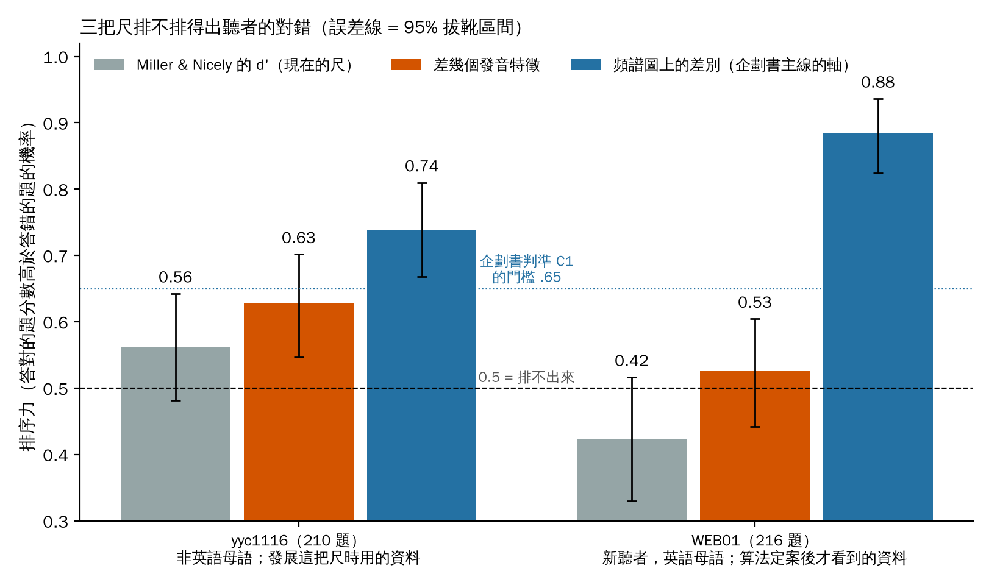
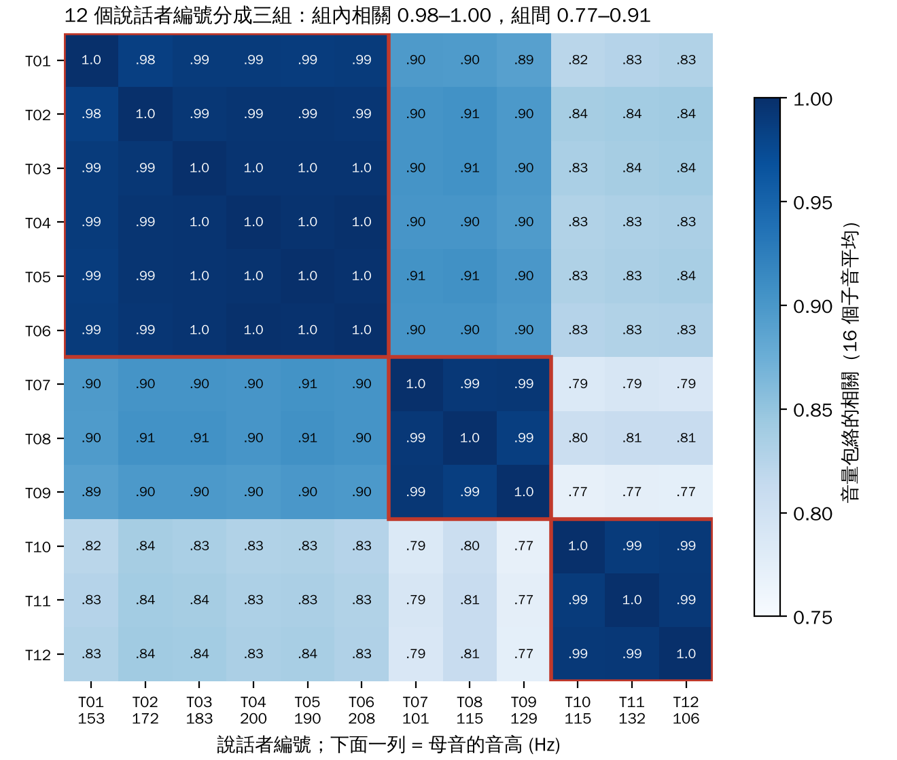

# 評估：現在的聲音尺 對 企劃書的做法（2026-11-24）

給研究者做決定用。**這份文件不做決定**，也沒有改實驗程式或 `DECISIONS.md`。
比較的兩邊：現在程式裡的做法（Miller & Nicely 的 d′ 表當軸），與 [[proposal_2026-11-24_language_independent_sound_scale]] 的主線 B（聲學尺 + 每人校準）。
企劃書寫完之後多了四樣證據（§2、§3），這裡一併納入。

標記：**【量】** 程式對資料或音檔算出來的；**【新檢驗】** 算法定案之後才看到的資料；**【事後】** 看過資料才做的比較；**【單人】** 只有一位聽者；
**【模擬】**；**【文獻】** repo 筆記裡查核過的；**【推論】** 沒有直接量；**【未入 repo】** 數字來自這次工作階段的暫存腳本，repo 裡還不能重跑。重現指令在附錄。

> **更新（2026-11-24）**：研究者確認 WEB01 是英語母語者。§0 的第 1、3 點、§5 的 C1 第二部分、§6 與 §7 的對應文字已據此改寫，改過的地方都標了「更新」。
> 他和 EN01 是不是同一個人沒有記錄。

## 0. 結論

1. **（更新）現在有一筆「英語母語者、在我們的噪音下」的資料，現在的尺排不出他的難易。**【量】【單人】WEB01 是英語母語者：M&N d′ 的排序力 .42 [.33, .52]，聲學尺 .88 [.82, .94]。EN01 仍只有乾淨條件（67 題錯 5）。只有一位、一場、SNR 順序固定且三段題目相同、只差清濁的對只測 3 題，所以能說的是「對這一位、在這個設定下無效」，不能推廣成「對英語母語者無效」。
2. **在已有的兩位聽者身上，現在的尺排不出難易，聲學尺排得出。**【量】排序力：M&N d′ .56 與 .42，頻譜圖差別 .74 與 .88（圖 33）。WEB01 那一筆是算法定案後才看到的資料【新檢驗】；yyc1116 那一筆是發展時用的【事後】。
3. **（更新）這個差距不能只用「聽者不是英語母語者」解釋**【推論，兩位聽者】：表對一位母語者（WEB01）也排不出來。剩下的可能來源彼此分不開：噪音種類（表來自白噪音，我們是語音形噪音）、母音（音檔不是 M&N 的 /ɑ/）、作業（辨認對同/異）、錄音（只有三組聲音）、線上施測。就這一位聽者而言，「只收英語母語者」救不了現在的尺。還缺的判別資料是只差清濁的對子（§7）：表說幾乎全對，聲學尺說最難，而兩位噪音下的聽者合計只測過 6 題。
4. **企劃書主線 B 的逐人判準，兩位聽者試算都過**【量】（C1、C2、C5，§5）；但 C3、C4（兩種母語之間）沒有資料可算，企劃書的核心主張「排序在兩種母語之間一致」仍未檢驗。
5. **B 的代價比企劃書寫的大**：每人要約 216 題不同 + 108 題相同才定得出 H（約 20 分鐘的前測）【模擬】【未入 repo】；單獨一場 72 題，兩位聽者六場裡只有一場落在範圍內【量】。實驗現有的校準階段每個維度只有 30 題不同試（`SFT_WM_nochange_EN.py:37`、`:303`）。
6. **兩個與做法無關的發現，兩邊都要處理**【量】：「12 位說話者」是三組近乎相同的聲音（圖 34）；音檔的母音不是 M&N 用的 /ɑ/（§3）。
7. 兩種做法不是只能二選一；§7 列了分階段的走法和每個決定點需要的結果。



## 1. 兩種做法各是什麼

### 現在的做法

- **程式碼字面**：聲音軸的單位是 d′，`LEVELS_AUDIO = [0.4, 0.9, 1.5, 2.3, 3.3, 4.5]`（`adaptive_vawm_EN.py:110`）；表由 `load_dprime` 讀 `stimuli/consonant_dprime.csv`（`adaptive_vawm_EN.py:204`），`foil_for` 在目標子音的 15 個 foil 裡挑 d′ 最接近層級的（`adaptive_vawm_EN.py:228`）；表的值 = 0.911 × Luce 距離（`make_sound_pairs.py:37`）。一個對子只有一個值，不分說話者；說話者每試從 `TALKERS` 的 12 個裡抽（`adaptive_vawm_EN.py:107`、`SFT_WM_nochange_EN.py:243`）。
- 校準：每個維度 6 級 × 5 題不同試 + 10 題相同試（`N_PER_LEVEL = 5`、`P_MATCH = 1/4`，`SFT_WM_nochange_EN.py:37-38`、`:303-304`），在記憶作業裡做；擬合用 `fit_points`（`adaptive_vawm_EN.py:345`），L = 50% 點、H = 到頂點；聲音軸進模型前只平移不縮放（`to_model_units` 回傳 `x + AUDIO_SHIFT`，`adaptive_vawm_EN.py:336`，`AUDIO_SHIFT = 0.0`，`:116`）。
- 噪音：`SND_SNR_DB = None`（`SFT_WM_nochange_EN.py:51`），也就是目前乾淨。`DECISIONS.md` 第 24 條的計畫是設一個固定 SNR，並用 M&N 同一 SNR 的矩陣重算 d′ 表。
- **受試者族群沒有定**：`DECISIONS.md`「還沒決定的」列著「正式受試者是否限定英語母語者」。下面把「現在的做法」分成「只收英語母語者」與「不限」兩種情況談。

### 企劃書的做法

- **主線 B**：軸換成「我們的噪音下，兩個音節的頻譜圖還剩多少差別」（`analyze/acoustic_scale_compute.py`），每位受試者自己擬合 50% 點與到頂點，並事先用兩個語言族群驗證、剔除排序不一致的對比類別。
- **備案 G**：不用尺，每位受試者直接量一組候選對子，各自選 H / L。
- 其他候選（A、C、D、E、F）見企劃書 §4；E（換材料）是設計決定，§7 的混合做法會再提到。

## 2. 企劃書之後的新證據

| # | 內容 | 數字 | 性質 | 來源 |
|---|---|---|---|---|
| N1 | 新聽者 WEB01，聲學尺的排序力 | .88 [.82, .94]；M&N d′ .42 [.33, .52]；特徵數 .53 [.44, .60]；216 題 | 【量】【新檢驗】【單人】，英語母語者（研究者確認） | `analyze/acoustic_scale_criteria.py`；`review/pilot_2026-11-24_WEB01_snr_pilot.md` |
| N2 | WEB01 的三個 SNR 可共用一條換算曲線 | 各自一條 對 共用：概似比 8.00，df 6，p = .24；x50 1.98 [1.65, 2.29]，x90 3.24 [2.70, 3.82] | 【量】【單人】 | `analyze/acoustic_scale_listener_curve.py` |
| N3 | 兩位聽者的曲線形狀差很多 | 斜率尺度 0.57 對 1.47 dB（2.6 倍）；x90 3.24 對 5.74；誤報 .03–.11 對 .23–.47 | 【量】 | 同上 |
| N4 | 每人要多少題才定得出 H | 216 不同 + 108 相同時，H 的中間 90% 範圍寬 2.4–2.9 dB；108 + 54 時 3.2–4.1 dB，與 L 到 H 的距離同寬 | 【模擬】【未入 repo】，曲線取自 yyc1116 | 工作階段暫存腳本 |
| N5 | 單獨一場（約 70 題不同試）用 `fit_points` | 在範圍內：WEB01 三場中一場、yyc1116 三場中零場；三場合併兩人都在範圍內 | 【量】 | `analyze/acoustic_scale_criteria.py --fit-points --by-snr` |
| N6 | L 的定義在誤報高時位置差很多 | P = .5 的點 對 曲線中點：yyc1116 0.94 對 2.51 dB；WEB01 1.91 對 1.98 dB | 【量】 | 同上 |
| N7 | 同一對在不同聲音之間差多少 | +6 dB：12 個編號之間的 SD 0.54 dB；同一組聲音內 0.22；三組之間 0.57 | 【量】 | `analyze/stimuli_voice_check.py` |
| N8 | 「12 位說話者」是三組 | 音量包絡相關：組內 .98–1.00，組間 .77–.91 | 【量】 | 同上，§3 |
| N9 | 母音不是 /ɑ/ | 192 個音檔母音中段 F1 / F2 / F3 中位數 530 / 1429 / 1853 Hz；F3 低於 2200 Hz 的 159 個 | 【量】 | 同上，§3 |
| N10 | 「華語沒有的子音誤報較高」沒有重現 | WEB01：1/33 對 7/75（yyc1116 當時 17/35 對 18/72） | 【量】【單人】，WEB01 是英語母語者（這些子音他都有類別，方向與類別的說法一致），但整體誤報太低、沒有鑑別力 | `analyze/native_category_false_alarms.py --participant WEB01` |

WEB01 這一場的限制【量】：SNR 順序固定 0 → +6 → +12 dB，三個 block 是同一組 108 題，所以 SNR 與練習、題目重複混在一起；只差清濁的對子只有 f–v 3 題。

## 3. 音檔的兩項核對

這兩項是另一份分析先提出的，這裡用 `analyze/stimuli_voice_check.py` 重新量過。

**說話者**【量】

- 把每兩個說話者編號、同一個子音的音檔重取樣到同一個取樣率，比 10 ms 的音量包絡，16 個子音平均：T01–T06 彼此 .98–1.00，T07–T09 彼此 .99，T10–T12 彼此 .99；不同組之間 .77–.91（圖 34）。
- 同一個編號的 16 個音檔，母音中段的音高幾乎完全相同（16 個檔的全距 0–3 Hz）；各編號的音高是 T01–T06：153、172、183、200、190、208 Hz；T07–T09：101、115、129；T10–T12：115、132、106。
- 聲學尺上，同一對在 12 個編號之間的差異主要是三組之間的差異（N7）；各編號在 120 對上的數值，組內相關 .99–1.00，組間 .90–.95。
- **推論**：一個人分 16 次錄音，音高不會一致到 3 Hz 以內；三組各自像是同一段聲音換了音高與取樣率做出來的變體。音檔的來源與製作方式 repo 裡沒有記錄（`review/論文規格書_聲音軸.md` A2 標為待填），所以這一句只是推論，要由提供音檔的人確認。



**母音**【量】

- 母音中段的 F3 中位數 1853 Hz，192 個音檔裡 159 個低於 2200 Hz。**推論**：F3 這麼低是捲舌央母音（像 "er"）的特徵，不是 /ɑ/（這條語音學的對應沒有在 repo 的文獻筆記裡，待查證）。
- **文獻**：M&N 的矩陣是 CV + /ɑ/（`review/論文規格書_聲音軸.md` B1）。

**對兩種做法的影響**【推論】

| | 現在的做法 | 主線 B |
|---|---|---|
| 說話者只有三組 | 表不分說話者，所以沒有「用錯值」的問題；但把 12 個編號當 12 位說話者抽樣，實際的變異來源只有 3 個，寫論文時「12 位說話者」的說法要改。同一對在三組聲音上的難度差（0.57 dB，約等於 WEB01 的斜率尺度 0.57 dB）會直接變成 H / L 內部的雜訊 | 軸本來就逐編號算，三組之間的差被算進去了；但「對子 × 說話者」可選的刺激實際上是「對子 × 3 組」，L、H 附近可用的刺激比以為的少；「留一位說話者」的交叉驗證要改成留一組；企劃書 §7 的「3 位說話者 × 2 個順序」要寫成每組各一 |
| 母音不是 /ɑ/ | 表是在 /ɑ/ 前量的，子音之間的混淆會隨後面的母音變（待查證）；這是「白噪音、母語」之外第三個與表的來源不一致的地方 | 軸直接從這批音檔算，不受影響；但軸只對這批音檔成立，換音檔要重算 |

## 4. 逐面向比較

「現在」= 現在的做法；「B」= 企劃書主線。每格後面是證據的性質。

| 面向 | 現在的做法 | 主線 B |
|---|---|---|
| (a) 對英語母語者有沒有效 | 乾淨：EN01 幾乎全對（67 題錯 5），排序力 .76 [.59, .91]，尺上幾乎沒有難的區段（240 對只有 14 對 < 0.8）【量】【單人】。噪音下：**沒有資料**。表本身是英語母語者量的【文獻】，原理上最有依據，但轉用到我們的噪音與母音沒有驗證過【推論】 | 乾淨：EN01 .81 [.60, .98]，與 M&N 的區間重疊，分不出好壞【量】【單人】。噪音下：**沒有已知母語者的資料**；WEB01（.88）若是母語者就是第一筆，但他的母語沒記錄 |
| (b) 對非母語者有沒有效 | yyc1116：.56 [.48, .64]，逐對 r = .07【量】【單人】。命中不隨層級上升 | yyc1116：.74 [.67, .81]【量】【事後】【單人】。只差清濁的對子幾乎沒測到（3 題） |
| (c) 在我們的噪音下對不對 | 表來自白噪音；第 24 條打算重算的也是 M&N 的白噪音矩陣。與聲學尺只有 r = .21，分歧最大的是只差清濁的對（b–p：表上 4.13，聲學尺上第 2 小）【量】。兩位噪音下的聽者表都排不出來（.56、.42）【量】，但原因是母語還是噪音種類分不開【推論】 | 直接在實驗用的噪音下算；兩位聽者的三個 SNR 都可以共用一條曲線，加 SNR 進去 AIC 沒有改善【量】。「低頻先被蓋掉所以清濁對變難」這個預測沒有行為資料檢驗【推論】 |
| (d) 給不給得出斜面上的 L / H | 乾淨：兩位英語沒問題的受試者六級幾乎全在天花板，L 校出來仍在天花板（第 24 條）【量】。噪音下：WEB01 在 0 dB 六級的命中是 .58 .83 .50 .58 .50 .50，不是一條斜面【量】【單人】 | 三場合併（約 210 題）：WEB01 L 1.79 [1.46, 2.07]、H 4.44 [3.27, 6.13]，在範圍內、0 發散；yyc1116 L 0.70 [−1.63, 1.50]、H 5.77 [2.41, 21.6]，在範圍內但 L 有 9% 無解【量】。單獨一場六場裡只有一場在範圍內（N5）。誤報高時 L 的定義要重新定（N6）。L 端的刺激多是只差清濁的對，而那一區沒有聽者資料【量】【未入 repo】 |
| (e) 每位受試者的時間 | 不用加：校準已經在實驗裡（每維度 30 題不同 + 10 題相同，另有暖身與填充）。但 30 題不同試夠不夠定出 L / H，EN01 的結果（50% 點在尺外）說明至少在乾淨條件下不夠【量】 | 多一段純知覺前測：約 324 題、20 分鐘（題數來自模擬 N4；時間來自 WEB01 的 324 題 19.7 分鐘【量】）。另外採用前要先做驗證實驗：12 人 × 720 題，照 WEB01 的速度每人約 44 分鐘【推論】 |
| (f) 要改的程式（只列） | `SFT_WM_nochange_EN.py:51`（`SND_SNR_DB`）；`make_sound_pairs.py`、`consonant_distance.py`（重算表的 SNR 參數）；`stimuli/consonant_dprime.csv` | 上面的 `SND_SNR_DB`，加上：一張「對子 × 說話者 → 差別」的表與讀它的程式（取代 `adaptive_vawm_EN.py:204` 的 `load_dprime`）；`foil_for`（`:228`）要多吃說話者；`LEVELS_AUDIO`（`:110`）改成 dB；`to_model_units`（`:336`）聲音軸要加縮放（這次試算是除以 2，見 §5）；`SFT_WM_nochange_EN.py:50` 的暫定 H / L、`:243` 的說話者抽法；`sound_perception_EN.py` 的軸；一段前測流程；`tests/`、`ARCHITECTURE.md` §3、`DECISIONS.md` |
| (g) 可重建性與可辯護性 | 表可由 `make_sound_pairs.py` 重建；引用的是一篇經典文獻。審稿人可能問：白噪音的表為什麼能用在語音形噪音？/ɑ/ 的表為什麼能用在別的母音？辨識作業的混淆為什麼能換成同 / 異作業的 d′（0.911 這個係數是 −6 dB 一個條件擬合的，`make_sound_pairs.py:37`）？非母語受試者為什麼適用？ | 軸可由音檔 + 噪音種子逐位元重建（`analyze/acoustic_scale_compute.py`）。審稿人可能問：為什麼所有時間、頻率等權重？視窗與頻帶怎麼定的？每組聲音每個子音只有一個音檔，量到的是子音還是這一次發音？這個量沒有文獻先例可引（相近的聽覺模型文獻待查證）；樣板觀察者遠優於人，所以它不是難度本身 |
| (h) 對選擇性影響的後果 | 尺排不出難易時，「L 比 H 難」不成立，選擇性影響就不成立：EN01 第一場聲音 H 較快 p = .39【量】。H 與 L 本來就是不同的子音對 | H 與 L 仍是不同的子音對，而且更集中：+6 dB 時差別最大的 10 對全部含 /ʃ/（7.8–8.4 dB），最小的 10 對是 b–v、b–p、m–v、b–k、p–v、g–k、b–m、f–p、k–p、k–v（1.1–1.8 dB）【量】（`analyze/acoustic_scale_use.py`）。H / L 因此同時是「擦音 對 塞音」的差別，選擇性影響成立時也不能只歸因於「好不好分」【推論】。每人的 H / L 是不同的刺激，跨人比較時刺激不同 |
| (i) 還缺什麼資料 | 一位已知的英語母語者在我們的噪音下的同 / 異資料；只差清濁的對子（表說很容易：b–p 4.13、g–k 4.32） | 同左兩項（聲學尺說這些對最難：+6 dB 時 1.4、1.7 dB）；兩個語言族群的資料（C3、C4）；每人 216 題以上時 L / H 的實測穩定度 |

**只差清濁的對子是兩把尺分歧最大、也最便宜的判別題**【推論】：同一題，表預測幾乎全對，聲學尺預測接近猜。噪音下的兩位聽者合計只測過 f–v 6 題（各 3 題，各命中 1）；EN01 的校準檔沒有記錄每題是哪一對，無法計數。

## 5. 企劃書判準的試算

定義照企劃書 §6，門檻沒有動。判準原本是對「每組 6 人至少 5 人」定的，這裡只是逐人試算，不是判定。

```
C1  每人逐題的排序力（聲學尺，該題說話者的值）≥ .65
C2  命中 ~ 差別  與  命中 ~ 差別 + SNR  兩個邏輯迴歸；
    AIC(差別) − AIC(差別 + SNR) < 2 算通過（加 SNR 沒有實質改善）
C5  50% 點與到頂點都落在測過的範圍內
    (a) 換算曲線  P(答不一樣 | x) = FA + (1 − FA − λ) / (1 + exp(−(x − x50)/s))
    (b) 實驗的校準 fit_points（對錯 + RT），x 換成聲學差別
```

| | WEB01（216 題） | yyc1116（210 題） |
|---|---|---|
| C1 排序力 | .88 [.82, .94] → 過 | .74 [.67, .81] → 過 |
| C1 第二部分（英語母語組：聲學尺不低於 M&N 減 .05） | （更新）.88 對 .42，過；單人 | 不適用：非母語 |
| C2 加 SNR 的 AIC 改善 | −1.2（157.2 → 158.4），SNR 係數 +0.048 / dB → 過 | −2.0（199.5 → 201.5），+0.004 / dB → 過 |
| C5 (a) P = .5 的點 / 到頂九成 | 1.91 / 3.24 dB，測過 0.00–9.99 → 在範圍內 | 0.94 / 5.74 dB，測過 0.66–11.51 → 在範圍內 |
| C5 (b) `fit_points`：L / H | 1.79 [1.46, 2.07] / 4.44 [3.27, 6.13]；無解 0%；發散 0；in_range ✓ | 0.70 [−1.63, 1.50] / 5.77 [2.41, 21.6]；L 無解 9%；發散 0；in_range ✓ |
| C5 (b) 只用一場 | 0 dB ✗、+6 dB ✓、+12 dB ✗ | 三場都 ✗ |
| C3、C4 | 算不了：要兩個語言族群 | 算不了 |

【量】`analyze/acoustic_scale_criteria.py --participants WEB01 yyc1116 --fit-points --by-snr`（取樣設定同實驗，seed 42；區間是 90%）。

讀法：

- yyc1116 的 C1、C2 不是獨立的檢驗（門檻的模擬就是用他的曲線定的，尺也是對著他的資料發展的）；WEB01 的才是。
- C5 (b) 的 x 在傳進 `fit_points` 前除以 2，因為聲音軸在模型裡沒有縮放、先驗是照 d′ 的 0.4–4.5 調的。這是這支程式的選擇，不是實驗的設定；換一個縮放結果可能不同，沒有試。
- 「在範圍內」用的是「這位聽者測過的 x 範圍」。正式實驗的可用範圍取決於選定的 SNR 與刺激集，要另外算。
- 企劃書 §7 說「讀真實資料算 C3、C4 的程式還沒寫」，現在仍然沒寫；C1、C2、C5 有了。

## 6. 現有證據支持到哪裡

**支持**

- 在我們的噪音下，M&N 的表排不出兩位聽者的難易（.56、.42，區間都含或低於 .5）。【量】
- 頻譜圖差別排得出這兩位聽者的難易，其中一位是事先定好算法才看到的資料。【量】【新檢驗】
- 放進頻譜圖差別之後，SNR 不再有額外的解釋力，兩位都是。【量】
- 聲學尺與 M&N 的表把對子排得很不一樣（r = .21），分歧集中在只差清濁的對。【量】
- 每人的換算曲線差很多（斜率尺度 2.6 倍、誤報差數倍），所以不論用哪把尺都需要每人校準。【量】
- 12 個說話者編號是三組聲音；母音不是 /ɑ/。【量】

**不支持、或還不能說**

- 「M&N 的表對英語母語者無效」：（更新）**只能說到「對一位母語者、在這個設定下無效」**。WEB01 是英語母語者，表的排序力 .42；但只有一人一場、順序固定、題目重複、清濁對只有 3 題。
- 「聲學尺不論母語」：**不能說**。沒有兩個語言族群的比較；兩位聽者的母語一位非英語、一位未知。
- 「兩把尺對不上是因為噪音種類」：只是解釋。只差清濁的對子（解釋的關鍵）兩位噪音下的聽者合計只有 6 題。
- 「聲學尺的 L 端選得對」：L 附近的刺激以只差清濁的對為主，那一區沒有資料。
- 「每人 216 + 108 題就夠」：來自模擬，模擬假設聽者像 yyc1116；WEB01 的曲線陡 2.6 倍，需要的題數可能不同，沒有重算。
- 「華語沒有的子音誤報較高」：yyc1116 的事後發現，WEB01 沒有重現，但 WEB01 不構成有效的反證（N10）。

## 7. 不是二選一：分階段與混合的走法

**混合做法**【建議的選項，不排序】

| | 做法 | 適用的情況 |
|---|---|---|
| H1 | 只收英語母語者，但軸仍換成聲學尺 | 若證據顯示問題出在噪音種類（與母語無關）。不需要兩族群的驗證實驗（C3、C4），只需要 C1、C2、C5 |
| H2 | 只收英語母語者，維持 M&N 的表，照第 24 條加噪音 | 若已知母語者在我們的噪音下，表排得出難易 |
| H3 | 聲學尺只用來挑候選對子，每人的 H / L 用直接量的（備案 G） | 若聲學尺排得出難易但每人校準不穩，或 C3 大面積不過 |
| H4 | 維持 M&N 的表，每人加一段前測直接量候選對子（G，不用聲學尺） | 若兩把尺都不想依賴；代價是每人約 20–25 分鐘 |
| H5 | 換材料（企劃書的 E） | 若研究者接受聲音維度不必是英語子音對；E1（只改 SNR）與第 24 條「SNR 不是層級」衝突 |

**分階段**

| 階段 | 做什麼 | 成本 | 看什麼 | 結果指向 |
|---|---|---|---|---|
| 0 | 確認 WEB01 的母語 | 問一句 | — | （更新，2026-11-24）**已確認是英語母語者**：下一格的問題有了第一筆答案（表 .42、聲學尺 .88），仍缺只差清濁的對子與隨機的 SNR 順序 |
| 1 | 一位已知的英語母語者做現成的線上 pilot；SNR 順序隨機、三個 block 不重複同一組題、記錄母語；題目加入只差清濁的對（企劃書附錄 A 有 7 對） | 約 20 分鐘 + 改線上版的題目表 | (i) M&N 的排序力；(ii) 聲學尺的排序力；(iii) 清濁對的命中 | 表排得出、清濁對幾乎全對 → H2 可行，問題主要在母語。表排不出、清濁對接近猜 → 問題在噪音種類，H2 不可行，看 H1 / B。全部在天花板 → 換較低的 SNR 再做 |
| 2 | 決定受試者族群（企劃書 §11 第 1 題） | 研究者決定 | — | 只收英語母語者 → H1 或 H2，不需要兩族群驗證。混合或非母語 → 企劃書的階段 1（12 人） |
| 3 | 每人校準的實測：2–3 人各做 324 題以上，看 L / H 的區間 | 每人約 20 分鐘 | L、H 的區間寬度與 L 到 H 的距離 | 區間窄於距離 → B / H1 的校準可行。否則 → H3 / H4 |
| 4 | 接上主實驗 pilot | 現有流程 | 聲音通道的存活函數序（`analyze/main_task_summary.py`） | — |

階段 1 的門檻沿用企劃書 C1 的 .65 當參考即可；這裡不另訂新門檻。

## 8. 企劃書待修訂清單

已在企劃書加了一節「13. 2026-11-24 之後的新證據與待修訂」指向本文；下列各項尚未改進企劃書正文，門檻數字沒有動。

1. **說話者**：§7「3 位說話者 × 2 個順序」、§10「逐題用該說話者的值」、§12「每位說話者每個子音只有一個音檔」都以 12 位為前提；實際是三組聲音。交叉驗證與模擬（`analyze/acoustic_scale_design_check.py`）裡的說話者數要改成 3。
2. **L 的定義**：§6 的 C5 與 §11 第 6 題沿用「50% 點」；誤報高時它與曲線中點差很多（N6），要明講用哪一個，以及誤報高到 P = .5 的點不存在時怎麼辦。
3. **每人題數與校準放在哪裡**：§5 說「像顏色維度那樣對每個人擬合」「`fit_points` 不用改」；N4、N5 顯示實驗裡每維度 30 題不夠，需要一段獨立的前測，§8、§9 要補這一段，`to_model_units` 也要加聲音軸的縮放。
4. **判準試算**：§6 可以加註 C1、C2、C5 在 WEB01 上的試算（§5），並寫明 C2 的「AIC 改善」是哪兩個模型相減。
5. **線上版**：`online/snr_pilot/experiment.js:5` 的 SNR 順序預設固定 0、6、12；三個 block 用同一組 108 題；沒有記錄母語。§7 的「記錄」欄已列母語與學英語年數，線上版要實際加上，並隨機化順序。
6. **證據表**：§2 加 WEB01（N1–N3）；§0 第 3 點與 §12 第一點「.74 沒有用新資料確認過」可以更新為「在一位英語母語的新聽者上是 .88」。
7. **母音**：§1「兩個不合用的地方」加第三個（表是 /ɑ/，音檔不是）。
8. **階段 0.5**：若 WEB01 是英語母語者，階段 0.5 已經做了一部分（缺清濁對與順序隨機化）；若不是，仍然要做。
9. **§7 的時間**：「約 42 分鐘」是推算；WEB01 實測 324 題 19.7 分鐘，720 題約 44 分鐘。
10. **C3、C4 的分析程式**仍未寫。

## 9. 限制

- 噪音下只有兩位聽者，各一場，都是三個 SNR 各 72 題不同試；其中母語者那一位 SNR 順序固定、三段題目相同。
- N4（題數模擬）與「L 端選到哪些對子」來自工作階段的暫存腳本，repo 裡還不能重跑；採用前要把它們整理進 `analyze/`。
- §3 的「同一段聲音做出來的變體」「捲舌央母音」是從量到的相似度與共振峰推論的，沒有音檔來源的文件可對。
- §4 (h) 關於「H / L 同時是擦音對塞音」是從 +6 dB 的刺激清單推論的；實際選到哪些刺激取決於每人的 L / H 與選定的 SNR。
- `fit_points` 的試算用了一個自選的縮放（除以 2）。
- 文獻只引用 repo 裡查核過的（M&N 1955、Cutler et al. 2004）；語音形噪音下清濁線索的行為文獻、母音環境對子音混淆的影響、頻譜距離類的聽覺模型，都標為待查證。

## 附錄：重現

從 repo 根目錄。前五行不需要 PyMC；第六行的 `--fit-points` 需要（每次擬合約一分鐘）。

```
python analyze/acoustic_scale_compute.py
python analyze/acoustic_scale_validate.py --participant yyc1116
python analyze/acoustic_scale_validate.py --participant WEB01
python analyze/acoustic_scale_listener_curve.py --participant WEB01 --compare yyc1116
python analyze/stimuli_voice_check.py                                   # §3；母音共振峰需要 praat-parselmouth
python analyze/acoustic_scale_criteria.py --participants WEB01 yyc1116 --fit-points --by-snr   # §5
python analyze/evaluation_figs.py                                       # fig33、fig34 的來源圖
```

`acoustic_scale_criteria.py` 不加 `--fit-points` 時只算 C1、C2 與 C5 (a)，寫出的 json 就沒有 C5 (b)；要畫圖只需要前者。
