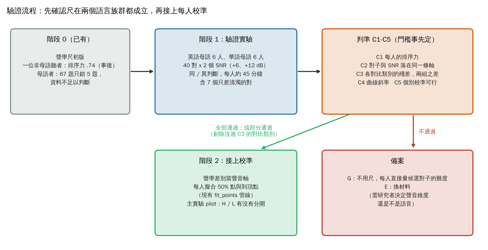
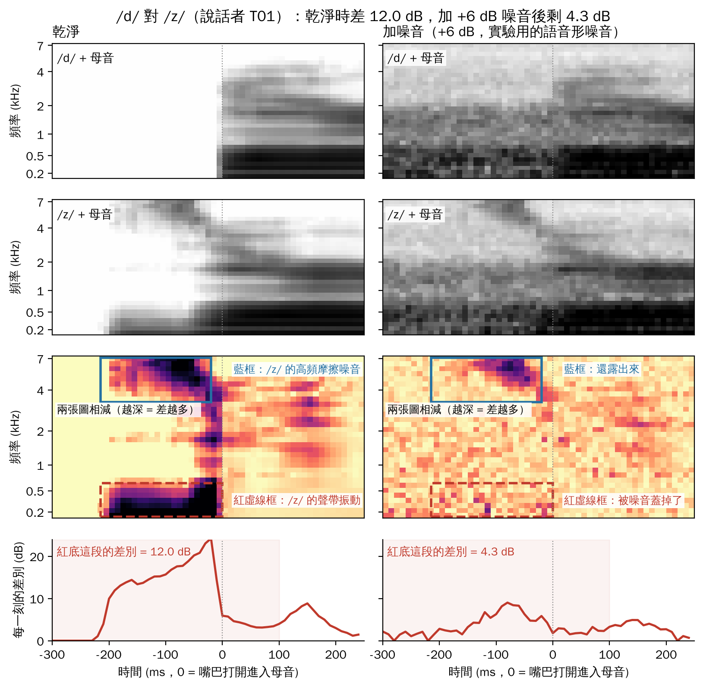
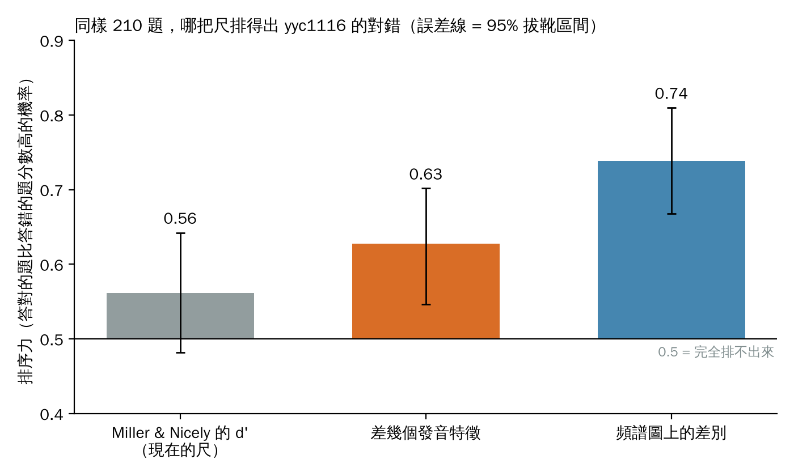
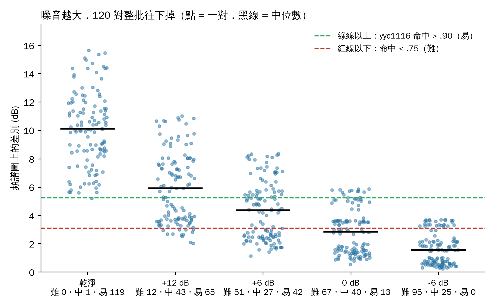
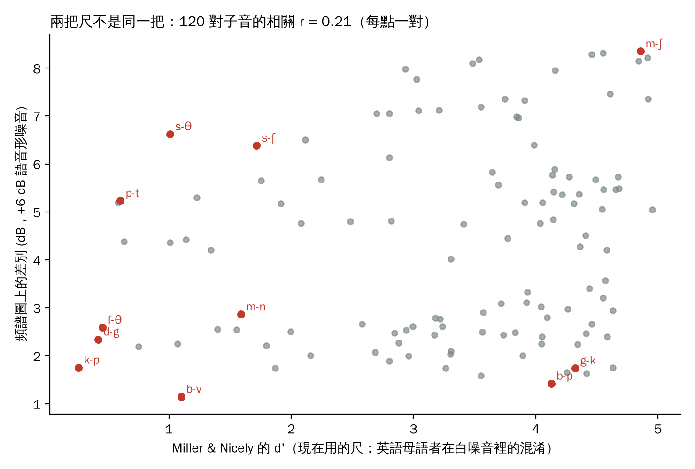

# 企劃書：不論母語的聲音難度尺（2026-11-24）

這是提案，不是變更：實驗程式、`DECISIONS.md` 都沒有動。採用與否、採用哪一條路線，由研究者決定（§11 列出要決定的事）。

標記：**【量】** 程式對資料或音檔算出來的；**【事後】** 看過資料才做的比較；**【單人】** 只有一位聽者；**【文獻】** repo 筆記裡查核過的文獻；**【推論】** 從上面推出來、沒有直接量；**【建議】** 本文的主張。數字的重現指令在附錄 B。

## 0. 結論

1. **嚴格意義的「不論母語的尺」做不到。**【推論】聽者依母語對線索加權不同，改變的可能是對子的「排序」而不只是整體難度；任何只看聲音的尺都量不到這件事。能做到的是三件事合起來：(a) 一條每位聽者都單調的物理軸，(b) 每位受試者自己的校準吸收整體難度與判準的差異，(c) 事先用兩個語言族群驗證，把排序不一致的對子剔掉。
2. **建議主線（B）：聲學尺 + 每人校準。**【建議】用「我們的噪音下，兩個音節的頻譜圖還剩多少差別」當聲音軸（已有初版，`analyze/acoustic_scale_*.py`），像顏色維度那樣對每個人擬合 50% 點與到頂點（`adaptive_vawm_EN.py:345` 的 `fit_points`，不用改）。
3. **現有證據只夠說「值得驗證」。**【單人】【事後】這把聲學尺排得出一位非母語聽者的對錯（排序力 .74），優於現在的 Miller & Nicely d′（.56）；但英語母語者在噪音下的資料一筆都沒有，只差清濁的對子也幾乎沒測到（3 題）。
4. **先做一個小驗證實驗再決定**：英語母語 6 人、華語母語 6 人，40 對 × 2 個 SNR，每人約 45 分鐘；五條判準與門檻在 §6 事先定好。
5. **備案（G）**：驗證不過就不用尺，每位受試者直接量候選對子的難度、用自己的資料選 H / L。換材料的做法（E）需要研究者先決定「聲音維度還是不是語音」。
6. **附帶發現，與受試者母語無關**：現在的 d′ 表來自白噪音，我們用語音形噪音，兩者把對子排得很不一樣（r = .21）。【量】`DECISIONS.md` 第 24 條打算「用 M&N 同一 SNR 的矩陣重算 d′ 表」，在這個差異釐清前不宜照做。



## 1. 問題

聲音維度要一把「難度尺」：給定一對子音，預測受試者分不分得出來，才能替每個人選 H（容易）與 L（勉強）。

- **程式碼字面**：聲音軸的單位是 d′，層級 `LEVELS_AUDIO = [0.4, 0.9, 1.5, 2.3, 3.3, 4.5]`（`adaptive_vawm_EN.py:110`）；表從 `stimuli/consonant_dprime.csv` 讀（`adaptive_vawm_EN.py:204` `load_dprime`，docstring 寫明是 Miller & Nicely 1955 在 -12 / -6 / 0 dB 的 Luce 距離 × 0.911）；每一試在目標子音的 15 個 foil 裡挑 d′ 最接近層級的那個（`adaptive_vawm_EN.py:228` `foil_for`）。噪音由 `SND_SNR_DB` 控制，目前是 `None`（`SFT_WM_nochange_EN.py:51`）。
- **這把尺的來歷**【文獻】：Miller & Nicely (1955) 的混淆矩陣來自英語母語者、白噪音、CV 音節（`review/millerNicely1955_噪音混淆_逐SNR.md`）。
- **兩個不合用的地方**：受試者不一定是英語母語者；我們的噪音是語音形噪音（`sft_noise.py:88` `mix_components`），不是白噪音。

## 2. 現有證據

全部來自這個 repo 的資料與音檔。「排序力」= 答對的題分數高於答錯的題的機率（AUC；0.5 = 排不出來，`analyze/acoustic_scale_validate.py:45`）。

| # | 發現 | 數字 | 性質 | 來源 |
|---|---|---|---|---|
| E1 | 乾淨條件下這把尺沒有「難」的區段 | d′ 表 240 個有序對只有 14 對 < 0.8 | 【量】 | `analyze/sound_scale.py` |
| E2 | 英語母語者乾淨條件幾乎全對 | EN01：71 題「不同」試中 67 題反推得出是哪一對，錯 5 題 | 【量】【單人】 | `analyze/acoustic_scale_validate.py` |
| E3 | 現在的尺排不出非母語聽者的難易 | yyc1116，0 / +6 / +12 dB，210 題：排序力 .56 [.48, .64]；75 個有序對的 r(命中, d′) = .07 | 【量】【單人】 | 同上；`analyze/snr_pilot_pairs.py` |
| E4 | 特徵數稍好 | 排序力 .63 [.55, .70]；差 1 / 2 / 3 / 4 個特徵的命中 .70 / .79 / .92 / .94 | 【量】【單人】 | 同上 |
| E5 | 聲學尺最好 | 排序力 .74 [.67, .81]；四等分命中 .53 / .77 / .87 / .94；AIC（命中 ~ SNR + 尺）：M&N 221.8、特徵數 215.2、聲學尺 201.5 | 【量】【單人】【事後】 | `analyze/acoustic_scale_validate.py` |
| E6 | 放進聲學尺後，SNR 自己不再有解釋力 | SNR 係數 +0.004 / dB（放 M&N 時 +0.076） | 【量】【單人】【事後】 | 同上 |
| E7 | 聲學尺和現在的尺不是同一把 | 120 對，+6 dB：r = .21；各自最難的 20 對只重疊 4 對 | 【量】 | `analyze/acoustic_scale_validate.py`、`acoustic_scale_use.py` |
| E8 | 分歧最大的是只差清濁的對 | b–p：M&N d′ 4.13，聲學尺 120 對裡第 2 小；g–k：4.32，第 6 小 | 【量】 | `analyze/acoustic_scale_use.py` |
| E9 | 語音形噪音先蓋掉低頻 | +6 dB 時，0.4 kHz 以下的差別只剩乾淨時的 17%，3 kHz 以上剩 62% | 【量】 | `analyze/acoustic_scale_figs.py` |
| E10 | 只差清濁的對幾乎沒測到 | yyc1116 的 210 題裡只有 3 題（都是 f–v），命中 1 | 【量】 | `analyze/acoustic_scale_validate.py` |
| E11 | 「相同」試的誤報在華語沒有的子音上較高，噪音小時消失 | θ ð v z ʒ 17/35 對其餘 18/72，Fisher p = .027（未校正）；+12 dB 時 2/9 對 6/26 | 【量】【單人】【事後】 | `analyze/native_category_false_alarms.py` |
| E12 | 樣板觀察者遠優於人 | 0 dB 時 120 對裡只有 16 對正確率 < .90；yyc1116 在 0 dB 的命中約 .7 | 【量】 | `analyze/acoustic_scale_use.py` |
| E13 | 非母語者整體差一截、差距不隨 SNR 變；難的音素兩群一樣難 | 荷蘭聽者 ≈ 美國聽者的 80%；逐音素正確率跨群相關 .83–.91；唯一清楚的母語效應在詞尾清濁 | 【文獻】Cutler et al. (2004)，p. 3670–3676 | `review/Cutler2004_全文查核.md` |
| E14 | 白噪音裡清濁與鼻音最耐蓋 | M&N p. 349 | 【文獻】 | `review/millerNicely1955_噪音混淆_逐SNR.md` |

各 SNR 下 120 對在聲學尺上的分布【量】。難 / 易的界線是用 yyc1116 的邏輯曲線換算的（命中 < .75 = 差別 < 3.1 dB；> .90 = 差別 > 5.3 dB）【單人】【事後】，只是示意：

| SNR | 差別的中位數 | 難 / 中 / 易 |
|---|---|---|
| 乾淨 | 10.1 dB | 0 / 1 / 119 |
| +12 dB | 5.9 dB | 12 / 43 / 65 |
| +6 dB | 4.4 dB | 51 / 27 / 42 |
| 0 dB | 2.9 dB | 67 / 40 / 13 |
| -6 dB | 1.6 dB | 95 / 25 / 0 |






另有 `figures/fig28_acoustic_frequency_profile.png`（E9）與 `figures/fig29_acoustic_hit_by_quartile.png`（E5）。

**怎麼讀這些證據**【推論】：

- E7–E9 加上 E14 指向「兩把尺對不上，主因可能是噪音種類」：白噪音裡低頻的聲帶振動留得住，語音形噪音先把它蓋掉。這個解釋沒有直接檢驗；E10 說明現有的聽者資料也幫不上忙。
- E13 是好消息但不能直接套用：它是音素辨識、babble 噪音、荷蘭聽者；我們是同 / 異判斷、語音形噪音、華語聽者。它支持的是「母語主要造成整體位移」這個可能性，同時也示範了例外長什麼樣（一個特定的對比類別、由母語音韻造成）。
- E12 表示聲學尺的絕對值不能當難度：聲音裡的資訊遠多於人用到的。它只能排序，換算成命中率要靠聽者自己的資料。

## 3. 「不論母語」拆成可檢驗的條件

| 條件 | 內容 | 只看聲音的尺做得到嗎 |
|---|---|---|
| N1 單調 | 每位聽者，尺上的值越大越容易分辨 | 可以檢驗；E5 是一位聽者的證據 |
| N2 單一軸 | 對子不同、SNR 不同，只要尺上的值相同，難度就相同 | 可以檢驗；E6 是一位聽者的證據 |
| N3 排序一致 | 兩個語言族群把對子排成同樣的難易順序 | **原理上不保證**：聽者依母語加權線索，會改的正是排序。只能驗證、剔除不一致的對比類別 |
| N4 形狀一致 | 兩族群「尺 → 命中率」的曲線斜率相同，只差位置 | 不保證；位置的差異可由每人校準吸收，斜率的差異也可以（每人各擬合一條），但斜率差很多時 H 與 L 之間的間距對兩族群意義不同 |
| N5 可校準 | 每位受試者在可用的範圍內都找得到 50% 點與到頂點 | 取決於 SNR 與對子的範圍，是設計問題 |

所以「不論母語」可以落實成：**N1、N2、N5 對每個人成立；N3 在保留下來的對子上成立；N4 的差異在容許範圍內**。N3 不成立的對比類別不是尺壞了，而是那個類別對兩族群本來就不是同一件事，該剔除。

## 4. 候選做法

| | 做法 | 需要的新資料 | 滿足 | 風險 | 成本 |
|---|---|---|---|---|---|
| A | 聲學尺：我們的噪音下頻譜圖剩餘的差別，直接當難度 | 無（已算好） | N1、N2 待驗；N3–N5 不處理 | 絕對值不是難度（E12）；不看聽者 | 最低 |
| **B** | **A 當軸 + 每位受試者校準 50% 點與到頂點** | 驗證實驗（§7）；之後每人的校準試次（現在就有這個階段） | N1、N2、N5 逐人檢驗；N4 由校準吸收；N3 靠事先剔除 | N3 大面積失敗時剩下的對子不夠 | 中：一個驗證實驗 + 換一張表與層級單位 |
| C | 每個族群各收一張混淆（或同 / 異）表 | 每個族群數千試 | 族群內 N1–N5；跨族群沒有共同的尺 | 每換一個族群重收；混合樣本無法處理 | 高。§7 的資料順便給出 40 對 × 2 個 SNR 的族群表，可當 B 失敗時的局部替代 |
| D | 聽者模型加權的聲學尺：頻帶 / 時間的權重由資料估 | 每個族群數百試以上 | 變成每個族群一把尺 | 參數多、容易過度擬合 | 中高。**不當主線，當診斷工具**：N3 失敗時用來看是哪個頻帶被忽略 |
| E | 換材料：(E1) 同一對音只改 SNR 當層級；(E2) 類別內的聲學連續體；(E3) 非語音 | 新刺激與新的校準 | 定義上不論母語（E1、E3） | E1 違反 `DECISIONS.md` 第 24 條「SNR 是環境常數、不是層級」，H 與 L 的噪音聽得出不同；E2、E3 改變「聲音維度在測什麼」 | 高，且是設計決定 |
| F | 特徵數當軸 | 無 | N1 弱（E4：.63） | 只有 5 級；特徵的權重本身依語言 | 最低；不建議單獨用 |
| **G** | **不用尺：每位受試者直接量一組候選對子，各自選 H / L** | 每人多 25 分鐘左右的前測 | 逐人成立，因為是量的不是預測的 | 每人的 H / L 是不同的子音對；可能有人找不到夠多的 L | 中：每人的時間 |

D 的現成線索【單人】【事後】：把聲學尺的視窗縮到「只看母音開頭 100 ms」，yyc1116 的排序力從 .74 掉到 .56；只看母音之前則是 .75（`analyze/acoustic_scale_use.py:29` 的 `WINDOWS`）。

## 5. 建議

**主線 B，備案 G。**【建議】

- **為什麼是 B**：它把問題拆成兩半，各用合適的工具。物理軸負責「排序」（跟母語無關的部分），每人校準負責「位置」（跟人有關的部分）。這跟顏色維度的做法一樣：ΔE 是物理軸，每個人的 50% 點不同。現有的校準管線（`fit_points`，`adaptive_vawm_EN.py:345`）只吃「刺激值、RT、對錯」，換軸不用改它。
- **為什麼不是 A**：A 少了校準，等於假設所有人在同一個差別值上同樣難；E12、E13 都說不是。
- **為什麼備案是 G 不是 C**：G 不依賴任何尺成立，B 失敗時仍然可用；C 要先決定族群而且資料量大。聲學尺在 G 裡仍有用處：拿來挑候選對子。
- **E 不排優先序**：它不是技術問題，是「聲音維度要不要還是語音」的問題（§11 Q2）。

聲學尺的定義【量】（`analyze/acoustic_scale_compute.py:117` `pairs`）：

```
  S_a(t, f)   音節 a 的 mel 頻譜圖（dB）：32 個頻帶 0.1–7 kHz，10 ms 一格，
              t 以「嘴巴打開進入母音」為 0，取 −300 到 +100 ms

  D(a, b)     = rms over (t, f) of [ S_a − S_b ]          同一位說話者；兩個音用不同的噪音樣本
  floor(a)    = 同一個音、兩段不同噪音的 D                   噪音自己造成的差
  差別(a, b)  = √( D(a, b)² − ( floor(a)² + floor(b)² ) / 2 )
```

一位聽者的換算【單人】【事後】（`analyze/acoustic_scale_use.py:96`）：

```
  P(答「不一樣」) = logistic( −0.50 + 0.51 × 差別 )        差別的單位是 dB
  命中 .60 → 1.8 dB     .75 → 3.1 dB     .90 → 5.3 dB
```

## 6. 判準（事先定，不事後調）

驗證實驗（§7）收完後，照下表判定。門檻的來源是 `analyze/acoustic_scale_design_check.py` 的模擬（附錄 B）：假設聽者的曲線像 yyc1116 那樣，每組 6 人、每人 480 題「不同」試。

| 判準 | 對應 | 算法 | 通過 | 模擬裡的參考值 |
|---|---|---|---|---|
| C1 排序力 | N1 | 每人逐題 AUC（聲學尺，該題說話者的值） | 每組 6 人中至少 5 人 ≥ .65；且英語母語組合併後聲學尺的 AUC 不低於 M&N d′ 的 AUC 減 .05 | 每人 .77 [.72, .81] |
| C2 單一軸 | N2 | 每人邏輯迴歸：命中 ~ 差別，再加 SNR | 加 SNR 後 AIC 改善不到 2 的人，每組至少 5 人 | yyc1116：SNR 係數 +0.004 |
| C3 各對比類別的殘差 | N3 | 每組用「其餘對子」擬合 logit(命中) ~ 差別，算該類別的平均殘差；看兩組殘差之差 | 每個類別兩組之差的絕對值 ≤ 0.7 logit | 兩組相同時 0.0 [−0.31, +0.35]；一組在清濁對上差 2 logit 時 −2.0 [−2.3, −1.7] |
| C4 斜率 | N4 | 兩組各自的斜率（差別的係數，含每人的截距） | 兩組斜率之比在 0.67 到 1.5 之間 | — |
| C5 可校準 | N5 | 每人用「不同」試 +「相同」試（差別 = 0）擬合，求 50% 點與到頂點 | 兩個點都落在可用範圍內的人，每組至少 5 人 | — |

C3 的類別事先定為三類（附錄 A 的 40 對照這三類分）：只差清濁（7 對）、含華語沒有的子音 θ ð v z ʒ 但不是只差清濁（17 對）、其餘（16 對）。

判定：

- **全部通過** → 進階段 2：把聲學尺接上校準，做主實驗 pilot。
- **只有 C3 的某一類沒過** → 那一類的對子從刺激集剔除，其餘照走。兩類都沒過（24 / 40 對要剔）→ 視為不通過。
- **C1 或 C2 在任一組沒過，或 C4、C5 沒過** → 不通過，走備案 G。

為什麼不用「兩組逐對命中率的相關」當 C3【量】：模擬裡，兩組完全相同時 ρ = .90 [.86, .94]，一組在清濁對上差 2 logit 時 ρ = .81 [.74, .86]，兩個區間幾乎相接；同一情境下類別殘差是 0.0 對 −2.0，分得很開。相關係數會報告，但不當判準。

階段 2 的判準沿用現有的檢查（`analyze/main_task_summary.py`）：聲音通道的存活函數序在預期方向（H 較快）單尾 KS p < .05，且 L 的正確率在 .70 到 .90 之間。

## 7. 驗證實驗

**階段 0.5（先做，約 25 分鐘）**：一位英語母語者用現成的線上 pilot（`online/snr_pilot/`，0 / +6 / +12 dB 各 108 題）。目的只有一個：確認母語者在哪兩個 SNR 會出錯。現在母語者在噪音下的資料是零，直接開 12 人的實驗風險太高。

**階段 1**

| 項目 | 內容 |
|---|---|
| 受試者 | 英語母語 6 人、華語母語 6 人。人數的理由：C1、C2、C5 是逐人判定，每個人就是一次完整的重複；C3、C4 要用「對子 × SNR」的格平均，6 人 × 6 次 = 每格 36 題。人數若要改，改 `analyze/acoustic_scale_design_check.py:32` 的 `N_PER_GROUP` 重跑，看 C3 的兩個區間還分不分得開 |
| 作業 | 同 / 異判斷，沿用 `sound_perception_EN.py`（實驗室）或 `online/snr_pilot/`（線上）；兩個音節各用一個噪音種子（`sound_perception_EN.py:201` 已記錄） |
| 對子 | 40 個無序對（附錄 A）：7 個只差清濁的對全收，其餘 33 對照 +6 dB 的聲學差別等距取，範圍 1.1–8.3 dB。規則寫在 `analyze/acoustic_scale_design_check.py:35` `choose_pairs` |
| SNR | 預設 +6 與 +12 dB，階段 0.5 之後確定。兩組可以用不同的 SNR：C2 成立的話，聲學差別就是共同的單位 |
| 試次 | 每人 40 對 × 2 個 SNR × 6 次（3 位說話者 × 2 個順序）= 480 題「不同」+ 240 題「相同」（三分之一，同 `sound_perception_EN.py:49` 的 `P_SAME`）= 720 題 |
| 時間 | 約 42 分鐘（以 `sound_perception_EN.py:13-14` 寫的 120 題約 7 分鐘推算），依 SNR 分兩段、順序對調 |
| 計畫 | 對子、說話者、順序用固定種子排好，所有人相同（同 `online/make_snr_pilot_stimuli.py:33` 的 `PLAN_SEED` 做法） |
| 記錄 | 現有欄位（對子、說話者、兩個音檔、`snd_snr_db`、兩個種子、按鍵、RT、對錯）+ 母語、學英語的年數、段次 |

分析對應：

| 步驟 | 程式 | 狀態 |
|---|---|---|
| 逐人的 C1、C2 | `analyze/acoustic_scale_validate.py --participant <id> --snrs 6 12` | 已有 |
| 逐人的 C5 | `analyze/acoustic_scale_use.py`（邏輯曲線）；正式版走 `analyze/calibration_refit.py` 的 `fit_points` | 前者已有；後者要加「聲學差別」這個軸 |
| 兩組的 C3、C4 | 模擬用的統計量在 `analyze/acoustic_scale_design_check.py:55` `summarise` | **讀真實資料的版本還沒寫**，階段 1 收資料前補 |
| 聲學尺本身 | `analyze/acoustic_scale_compute.py` | 已有；SNR 改了要重跑 |

## 8. 若採用，程式要動哪裡（這裡不動）

- **程式碼字面**：`fit_points(xs, rts, corrects, dim, levels, fit_kw)`（`adaptive_vawm_EN.py:345`）只用到刺激值、RT、對錯與層級；聲音的單位換算是 `x + AUDIO_SHIFT`（`adaptive_vawm_EN.py:332`、`:116`）。
- **推論**：要換的是三樣——(1) 一張「子音對 × 說話者 → 聲學差別（在 `SND_SNR_DB` 下）」的表，取代 `stimuli/consonant_dprime.csv`；(2) `LEVELS_AUDIO` 改成 dB 單位的層級；(3) `SND_SNR_DB` 設值。`foil_for` 的邏輯（挑最接近層級的 foil）可以沿用。
- `DECISIONS.md` 第 24 條「還沒定」裡寫的「重算 `stimuli/consonant_dprime.csv`（換 SNR 參數）」是用 M&N 的白噪音矩陣；若採用本案，那一步要改成用聲學尺，並新增一條決定。

## 9. 時程與資源

| 週 | 工作 |
|---|---|
| 1 | 階段 0.5（一位英語母語者）；定 SNR；產生 40 對的固定計畫與刺激；補寫兩組比較的分析程式；重跑設計檢查 |
| 2–3 | 階段 1 收 12 人 |
| 4 | 分析、照 §6 判定、寫結果筆記 |
| 5 | 通過：接上校準 + 主實驗 pilot 2 人。不通過：備案 G 的前測設計 |

資源：英語母語受試者的來源（EN01 可做階段 0.5）；線上收資料需要 Pavlovia 的點數或授權（`online/snr_pilot/README.md` 第 3 步；金額待查）；每人要有耳機。

## 10. 風險與對策

| 風險 | 對策 |
|---|---|
| 母語者在 +6 / +12 dB 仍幾乎全對，排不出序 | 階段 0.5 先看；必要時母語組改用較低的 SNR（C2 允許） |
| 只差清濁的對在兩組差很多（C3 沒過） | 這是預期中可能的結果，不是失敗：剔除該類，其餘照走 |
| 剔除之後低差別的對子不夠當 L | 附錄 A 裡非清濁、+6 dB 時差別 < 3.1 dB 的還有 14 對；階段 1 的資料會顯示每人實際落在哪 |
| 同一對在不同說話者身上差別不同 | 逐題用該說話者的值（E5 就是這樣算的，比 12 位平均的 .72 略好） |
| 判準的門檻來自一位聽者的曲線 | 階段 0.5 後、收資料前重跑設計檢查更新門檻；收完資料後不再動 |
| 兩組的判準（誤報）不同（E11） | 擬合時把「相同」試放在差別 = 0，判準由截距吸收（同 `DECISIONS.md` 第 25 條的 b₀） |
| 鼻音的母音起點偵測有幾十毫秒誤差 | 敏感度分析顯示換視窗後排序力在 .73–.75 之間；正式採用前目視檢查 24 個鼻音檔 |

## 11. 需要研究者決定

1. 正式實驗的受試者是哪個族群：只收英語母語、只收華語母語、還是混合？只收單一族群的話，「不論母語」可以降成「對這個族群成立」，C 也成為選項。
2. 聲音維度一定要是英語子音對嗎？能不能換成同一對音只改 SNR（E1）、或非語音（E3）？
3. 階段 1 在 Pavlovia 還是實驗室做？
4. 每組 6 人可行嗎？英語母語者從哪裡找？
5. 兩組一定要用相同的 SNR 嗎？
6. 聲音的 H / L 沿用顏色的定義（50% 點、到頂點）嗎？
7. 如果只有清濁對沒過 C3，接受「不含清濁對」的刺激集嗎？
8. `DECISIONS.md` 第 24 條「用 M&N 同 SNR 的矩陣重算 d′ 表」要不要先擱置？

## 12. 限制

- 聲學尺對聽者的驗證只有一位非母語聽者，而且是事後比較；.74 沒有用新資料確認過。
- 英語母語者只有乾淨條件的 67 題、5 個錯，三把尺的排序力區間互相重疊（聲學尺 .81 [.60, .98]、M&N .76 [.59, .91]），分不出好壞。
- 只差清濁的對子幾乎沒測到（3 題）。E7–E9 的解釋（噪音種類）因此沒有行為資料支持；母語者可能靠很短的線索就分得出 b–p，聲學尺會低估這類對子。
- 樣板觀察者遠優於人（E12），聲學尺的絕對值不能當難度，也說不出該用哪個 SNR。
- 每位說話者每個子音只有一個音檔：這把尺量的是「這批音檔」的差別，分不開子音本身與這一次發音的特性。
- 所有時間、頻率等權重。這是它跟母語無關的原因，也是它量不到 N3 的原因。
- §6 的門檻來自模擬，模擬的曲線來自一位聽者；真實資料若有說話者效應等額外變異，C3 的區間會比模擬寬。
- 文獻只引用 repo 裡查核過的三篇。語音形噪音下清濁線索的行為文獻（例如 `review/millerNicely1955_噪音混淆_逐SNR.md` 列的 Woods et al. 2010，只看過摘要）待查證；華語聽者對英語清濁的文獻（同一份筆記列的 Flege 1989、Yang et al. 2026）也只到摘要層級。

## 附錄 A：建議的 40 對

+12 / +6 / 0 dB 的聲學差別（dB）、M&N d′、類別（V = 只差清濁，M = 含華語沒有的子音，O = 其餘）。【量】`analyze/out/acoustic_scale_design_pairs.csv`；清單是建議，待確認。

| 對 | +12 | +6 | 0 | M&N d′ | 類 | | 對 | +12 | +6 | 0 | M&N d′ | 類 |
|---|---|---|---|---|---|---|---|---|---|---|---|---|
| b–p | 2.1 | 1.4 | 0.8 | 4.13 | V | | d–f | 4.7 | 3.1 | 1.8 | 3.92 | O |
| d–t | 7.2 | 5.4 | 3.6 | 4.35 | V | | n–p | 5.0 | 3.4 | 2.0 | 4.44 | O |
| g–k | 2.6 | 1.7 | 0.9 | 4.32 | V | | d–z | 6.0 | 4.2 | 2.7 | 1.34 | M |
| f–v | 3.5 | 2.0 | 1.0 | 3.30 | V | | z–ʒ | 5.7 | 4.4 | 3.0 | 1.14 | M |
| ð–θ | 3.5 | 2.3 | 1.3 | 2.88 | V | | p–z | 6.7 | 4.8 | 3.0 | 4.04 | M |
| s–z | 5.9 | 4.7 | 3.6 | 3.41 | V | | m–z | 6.7 | 4.8 | 3.0 | 4.14 | M |
| ʃ–ʒ | 5.1 | 4.2 | 3.3 | 4.58 | V | | g–t | 6.9 | 5.2 | 3.5 | 4.31 | O |
| b–v | 2.0 | 1.1 | 0.6 | 1.10 | M | | t–z | 6.8 | 5.2 | 3.6 | 4.05 | M |
| b–m | 2.9 | 1.7 | 1.0 | 3.26 | O | | m–t | 7.4 | 5.4 | 3.6 | 4.15 | O |
| k–v | 2.8 | 1.8 | 0.9 | 4.63 | M | | k–ʒ | 7.6 | 5.5 | 3.5 | 4.68 | M |
| f–k | 3.3 | 2.0 | 1.1 | 2.16 | O | | ð–ʒ | 7.8 | 5.7 | 3.6 | 2.25 | M |
| ð–v | 3.3 | 2.2 | 1.2 | 0.75 | M | | b–ʒ | 8.3 | 5.8 | 3.6 | 4.13 | M |
| b–ð | 3.5 | 2.2 | 1.2 | 1.07 | M | | s–ʃ | 7.6 | 6.4 | 4.9 | 1.71 | O |
| f–m | 4.0 | 2.4 | 1.2 | 4.59 | O | | s–θ | 8.1 | 6.6 | 5.0 | 1.01 | M |
| f–g | 3.9 | 2.5 | 1.3 | 4.41 | O | | ʃ–t | 8.9 | 7.1 | 5.3 | 2.70 | O |
| k–θ | 3.6 | 2.5 | 1.5 | 2.00 | M | | b–s | 9.5 | 7.2 | 5.1 | 3.55 | O |
| f–θ | 3.7 | 2.6 | 1.6 | 0.46 | M | | n–s | 9.7 | 7.5 | 5.3 | 4.61 | O |
| b–d | 3.7 | 2.7 | 1.6 | 2.58 | O | | k–ʃ | 10.3 | 8.0 | 5.7 | 2.93 | O |
| ð–f | 4.3 | 2.8 | 1.5 | 3.18 | M | | p–ʃ | 10.6 | 8.2 | 5.8 | 3.54 | O |
| n–θ | 4.4 | 2.9 | 1.7 | 4.63 | M | | m–ʃ | 11.0 | 8.4 | 5.9 | 4.86 | O |

每個子音出現 3 到 7 次（g、n 最少）。m–n 沒有被等距規則選到；它是 yyc1116 錯最多的一對（6/16），要不要手動加入由研究者決定。

## 附錄 B：重現

從 repo 根目錄，依序（需要 numpy、scipy、pandas、matplotlib；不需要 PyMC）：

```
python analyze/acoustic_scale_compute.py         # 約 25 秒；寫 analyze/out/acoustic_scale_feats.npz、_pairs.csv
python analyze/acoustic_scale_validate.py        # E2、E3、E5–E7、E10 的數字
python analyze/acoustic_scale_use.py             # 分布表、E8、E12、換算曲線、敏感度
python analyze/acoustic_scale_figs.py            # fig24–fig29 的來源圖
python analyze/acoustic_scale_design_check.py    # 附錄 A 的清單、§6 的參考值（模擬 500 次，seed 20261124）
python analyze/snr_pilot_pairs.py                # E3 的 r = .07、E4
python analyze/native_category_false_alarms.py   # E11
python analyze/sound_scale.py                    # E1
```

`fig30_scale_validation_flow.png` 是手排的流程示意，不是資料圖。

## 附錄 C：文獻

- Cutler, A., Weber, A., Smits, R., & Cooper, N. (2004). Patterns of English phoneme confusions by native and non-native listeners. *JASA, 116*(6), 3668–3678. 全文查核：`review/Cutler2004_全文查核.md`。
- Miller, G. A., & Nicely, P. E. (1955). An analysis of perceptual confusions among some English consonants. *JASA, 27*, 338–352. 查核：`review/millerNicely1955_噪音混淆_逐SNR.md`。
- 校準模型與 SFT 的檢定：`DECISIONS.md` 第 24、25 條及其引用。
