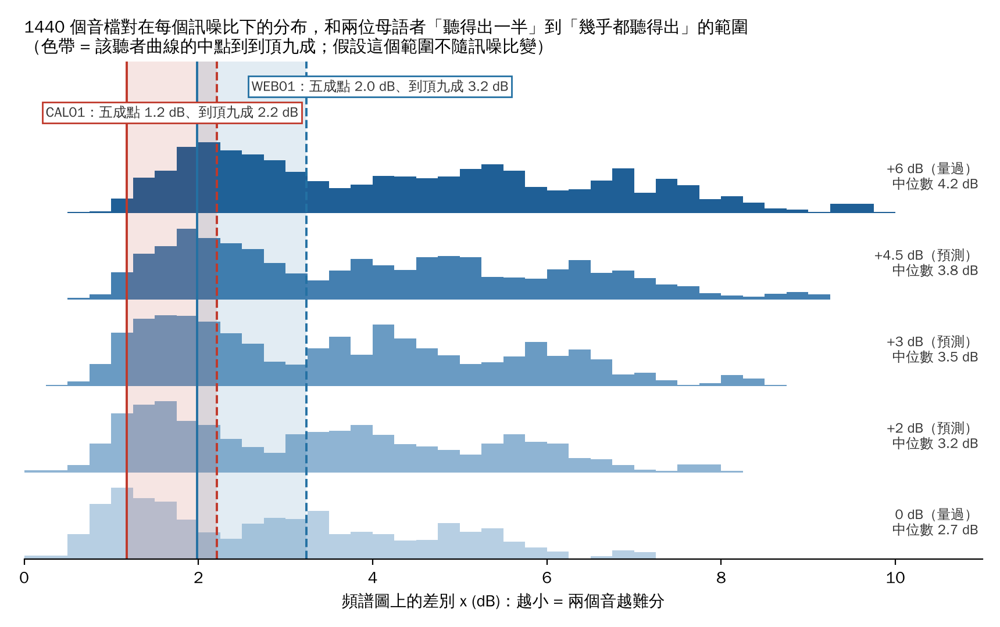
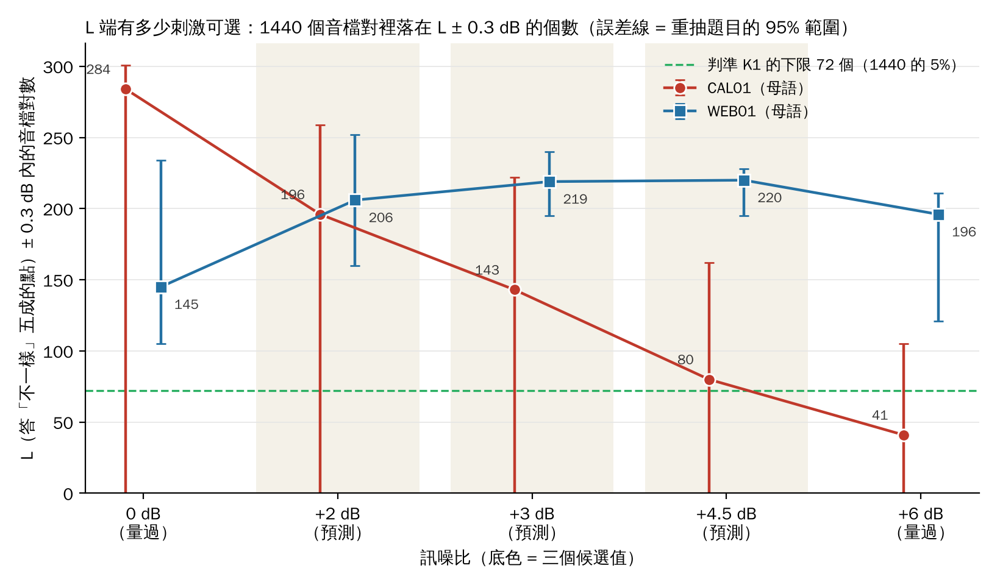
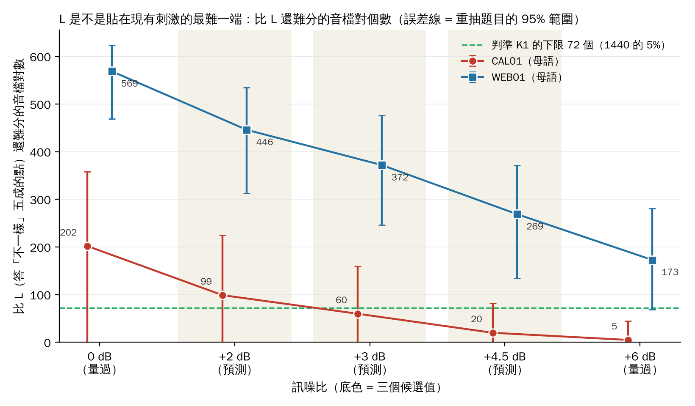
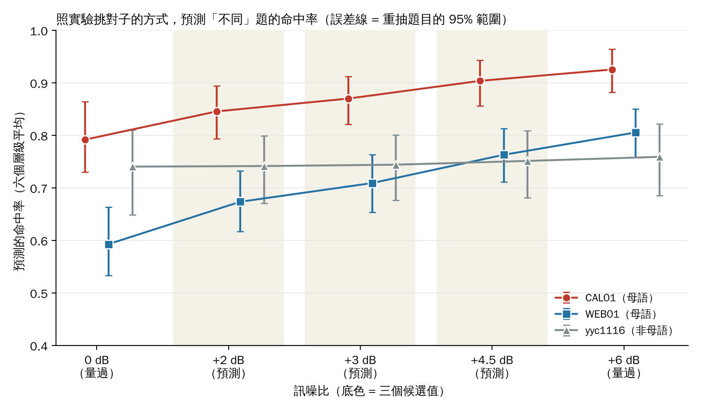
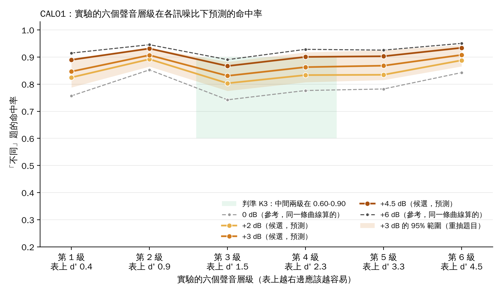
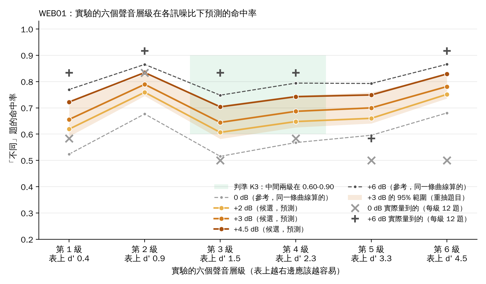
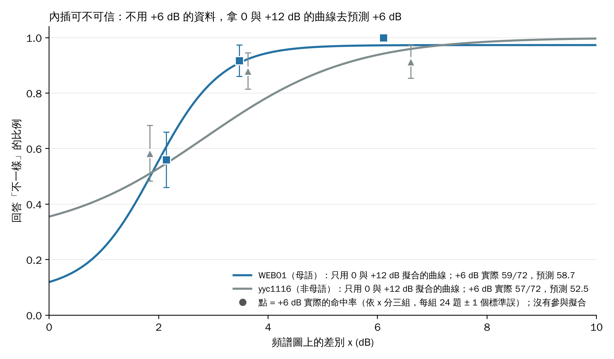

# SFT 的 SNR：+2、+3、+4.5 dB 哪一個最接近設計要的（2026-11-26；預測，不是量測）

給研究者做決定用。**這份文件不做決定**：沒有改 `SND_SNR_DB`、實驗程式、`data/`、`online/`、`DECISIONS.md`。
分析：`analyze/snr_candidates_compare.py`（新）。圖：`review/figures/fig39`–`fig45`。重現指令在最後。

標記：**【碼】** 程式碼字面寫的；**【量】** 對現有資料或音檔算出來的；**【預測】** 沒有人聽過的 SNR 上的數字，成立與否看 §2 的假設；
**【推論】** 沒有直接算。聽者資料都是【單人、單場】。

## 0. 結論

1. **三個裡 +4.5 dB 最不合適；+2 與 +3 dB 分不開；現行的 +3 dB 沒有被推翻。**【預測】
   照 §1 的四條判準，兩位英語母語者合計 8 格：+2 dB 過 8 格、+3 dB 過 7 格、+4.5 dB 過 7 格。
   沒過的都是 CAL01 的「L 端有沒有材料」：比 L 還難分的音檔對，+2 dB 有 99 個、+3 dB 60 個、+4.5 dB 20 個（門檻 72）。
   bootstrap 裡四條都過的比例（CAL01 / WEB01）：+2 dB .63 / .80，+3 dB .53 / .98，+4.5 dB .06 / .99。
   名義上最接近的是 +2 dB，但它對 +3 dB 的領先在雜訊之內，而且兩位聽者的方向相反。
2. **這份資料分得開的只有一件事：對 CAL01 那樣的聽者，+4.5 dB 會像 +6 dB 那樣讓 L 端材料不夠。**
   候選值之間的差（2.5 dB）比 CAL01 自己的不確定（換算成 SNR 約 ±3.3 dB）小，也比兩位母語者之間的差（約 3.3 dB）小；
   只比 WEB01 的不確定（±1.3 dB）大（§6）。
3. **三個值都改不了的事：實驗的六個聲音層級預測出來是平的。**【預測】在 +3 dB，六級的命中 WEB01 是 .66 .79 .64 .69 .70 .78、
   CAL01 是 .85 .91 .83 .86 .87 .91。換 SNR 只是整條上下移 .06–.09，不會長出斜面。這是尺（M&N 的 d′ 表）的問題，不是 SNR 的問題（§3.3）。
4. **全部是沒有記憶負荷的同 / 異判斷。** 記憶負荷會把聲音往難的方向推，推多少這裡沒有任何資料（§8）；
   這一點和「CAL01 需要更低的 SNR」方向相反，所以不能據此建議把 +3 往下調。

## 1. 判準（先定，再看結果）

設計要的【碼】：每位受試者兩個難度，L = 曲線的 50% 點、H = 到頂九成（`adaptive_vawm_EN.py:115` 的 `CALIB_PLATEAU`；DECISIONS 25）。
好的 SNR 是讓英語母語者的 L 與 H 都落在「真的有刺激」的地方。

四條判準是這支程式定的（`analyze/snr_candidates_compare.py:57`–`63`），不是實驗的設定：

| | 內容 | 門檻怎麼來的 |
|---|---|---|
| K1 L 端有材料 | L ± 0.3 dB 內 ≥ 72 個音檔對、來自 ≥ 20 個對子；且比 L 還難分的 ≥ 72 個 | 72 = 1440 的 5%。反例：CAL01 在 +6 dB，L 附近 41 個（12 對）、低於中點 15 個，當時被判為太少（`review/pilot_2026-11-26_CAL01_calib_pilot.md` §5） |
| K2 H 端有材料 | H ± 0.3 dB 內 ≥ 72 個、≥ 20 對；且比 H 還容易的 ≥ 72 個 | 同上。同一場 H 附近 206 個（47 對），算夠 |
| K3 中段不在天花板 | 實驗第 3、4 級（表上 d′ 1.5、2.3）預測命中的平均在 .60–.90 | 上限：CAL01 在 +6 dB 八格有六格 ≥ .96。下限 .60 是自選的：再低，六級裡到頂的只剩最上面一兩級 |
| K4 誤報不高 | 「相同」題的誤報 ≤ .20 | 自選。量到的：WEB01 .03–.11、CAL01 .09、yyc1116 .23–.47 |

「最接近」的定義：兩位母語者 × 四條 = 8 格裡過幾格；同分時看 bootstrap 裡四條都過的比例，取兩人中較低的那個。
± 0.3 dB 沿用 `analyze/calib_pilot_report.py` 挑 L / H 候選的寬度。
企劃書的 C1–C5（`review/proposal_2026-11-24_language_independent_sound_scale.md` §6）裡和「選哪個 SNR」直接有關的只有 C5「兩個點都落在可用範圍內」，K1、K2 是把它寫成數字。

**門檻改過一次，照實寫**：第一版「附近至少幾個」寫 100。跑出來才發現 1440 個音檔對在分布中段每 0.6 dB 本來就只有 110 個上下，
門檻壓在那裡，K2 過不過變成和 SNR 無關的擲銅板。改成和「低於 L 至少 5%」同一條規則（72）。兩種門檻都報在 §3.4；排序不變。

## 2. 做法與假設

```
  換算曲線（每位聽者一條，量過的 SNR 共用）

      P(答「不一樣」| x)  =  FA + (1 − FA − λ) / (1 + exp(−(x − x50) / s))

      H  =  x90  =  x50 + s · ln 9                          到頂九成
      L  =  x50 + s · ln( q / (1 − q) ),   q = (0.5 − FA) / (1 − FA − λ)        P = .5 的點

  x   = 這一對、這位說話者、這個 SNR 的「頻譜圖上的差別」(dB)
  FA  = 這個 SNR「相同」題的誤報（量到的，不擬合）
```

程式碼字面寫的【碼】：

- 曲線的式子與擬合：`analyze/acoustic_scale_listener_curve.py:45`–`49`（概似）、`:53`（擬合）。這裡直接 import，沒有重寫。
- x 的算法：`analyze/acoustic_scale_compute.py:135`（扣掉噪音底）。SNR 清單是模組層級的 `SNRS`（`:42`），這裡把它換成 0 / 2 / 3 / 4.5 / 6 再呼叫
  （`analyze/snr_candidates_compare.py:77`），演算法沒有動。
- 實驗怎麼挑對子：目標子音與說話者編號均勻抽（`SFT_WM_nochange_EN.py:238`），foil = 表上 d′ 最接近該層級的那個
  （`SFT_WM_nochange_EN.py:278` 呼叫 `adaptive_vawm_EN.py:228` 的 `foil_for`），層級是 `LEVELS_AUDIO`（`adaptive_vawm_EN.py:110`）。
  所以每一級 = 16 個目標子音 × 12 個編號 = 192 個等機率的音檔對（`analyze/snr_candidates_compare.py:92`）。
- 聲音校準的題數：每級 5 題 × 6 級 = 30 題「不同」、10 題「相同」、8 題插入題（`SFT_WM_nochange_EN.py:37`–`40`、`:303`–`305`）。

從資料 / 程式推導出來的，都靠下面三個假設【預測】：

1. **同一位聽者的 x50、s、λ 不隨 SNR 變**，SNR 只改變每個音檔對的 x 和誤報。只在 0 / +6 / +12 dB 之間、對 WEB01 與 yyc1116 檢驗過（§5）；CAL01 只有 +6 dB，沒辦法驗。
2. **沒量過的 SNR 的誤報**：WEB01、yyc1116 在量過的 SNR 之間線性內插；CAL01 只有一個值（.093），當成不隨 SNR 變。換假設的結果在 §4。
3. x 用分析自己的 6 段噪音平均（`analyze/acoustic_scale_compute.py:107`），不是實驗每一題實際那一段噪音。

核對過的【量】：0 與 +6 dB 的 x 和既有的 `acoustic_scale_pairs.csv` 逐格相同（最大差 0）；三條曲線重現筆記裡的數字
（CAL01 1.18 / 2.21、WEB01 1.98 / 3.24、yyc1116 2.51 / 5.74；共用一條的 p = .24、.30）；CAL01 在 +6 dB 那一列重現前測筆記的 15 / 1150 / 41 / 206。

## 3. 結果

### 3.1 L 與 H 落在 1440 個音檔對的哪裡（圖 39–41）



圖 39：每一橫條是一個 SNR 下 1440 個音檔對的 x 分布（越右越好分）。SNR 每高 1 dB，同一個音檔對的 x 增加約 0.24 dB；
從 +2 到 +4.5 dB 中位數增加 0.61 dB（10%–90%：0.33–0.97）【量】。紅、藍色帶是兩位母語者的「中點到到頂九成」。
CAL01 的色帶在分布的左緣，SNR 越高、它左邊剩的音檔對越少；WEB01 的色帶在分布裡面，三個候選值都有材料。

| 聽者 | SNR | 低於中點 / 之間 / 高於 x90 | 比 L 還難分的 | L ± 0.3 dB（對子數） | H ± 0.3 dB（對子數） | 沒過的判準 | 四條都過的比例 |
|---|---|---|---|---|---|---|---|
| CAL01 | 0（外推） | 252 / 371 / 817 | 202 | 284（53） | 109（41） | — | .78 |
| L 1.10、H 2.21 | **+2** | 134 / 397 / 909 | 99 [0, 225] | 196（37） | 162（39） | — | .63 |
| | **+3** | 83 / 392 / 965 | 60 [0, 159] | 143（30） | 196（46） | K1 | .53 |
| | **+4.5** | 32 / 340 / 1068 | 20 [0, 82] | 80（18） | 204（47） | K1 | .06 |
| | +6（量過） | 15 / 275 / 1150 | 5 [0, 45] | 41（12） | 206（47） | K1、K3 | .00 |
| WEB01 | 0（量過） | 572 / 297 / 571 | 569 | 145（39） | 194（39） | K3 | .07 |
| L 1.9–2.0、H 3.24 | **+2** | 459 / 265 / 716 | 446 [313, 535] | 206（48） | 142（38） | — | .80 |
| | **+3** | 393 / 281 / 766 | 372 [246, 476] | 219（50） | 100（36） | — | .98 |
| | **+4.5** | 288 / 345 / 807 | 269 [134, 371] | 220（48） | 85（33） | — | .99 |
| | +6（量過） | 204 / 374 / 862 | 173 [69, 281] | 196（39） | 116（36） | — | .97 |
| yyc1116（非母語，參考） | **+2** | 598 / 657 / 185 | 0 | 3（2） | 123（33） | K1、K4 | .00 |
| H 5.74；L 隨誤報大幅移動 | **+3** | 557 / 622 / 261 | 1 | 9（6） | 115（40） | K1、K4 | .00 |
| | **+4.5** | 472 / 637 / 331 | 6 | 48（11） | 78（37） | K1、K4 | .01 |

方括號是 bootstrap 95% 區間。「量過」指那個 SNR 有這位聽者的資料；表裡的數字仍是同一條曲線算的。【量】／【預測】



圖 40：L ± 0.3 dB 內有幾個音檔對。CAL01 隨 SNR 上升一路減少（+2 dB 196 → +4.5 dB 80 → +6 dB 41），WEB01 幾乎不動（206–220）。
CAL01 的誤差線從 0 到兩百多：他的 L 本身的區間是 [−0.39, 1.40] dB，下半段比幾乎所有現有的音檔對都小（+3 dB 時最小的 x 是 0.42 dB）。



圖 41：比 L 還難分的音檔對數，也就是 L 是不是貼在現有刺激的最難一端。CAL01 在 +3 dB 剛好掉到門檻下（60 對 72），+4.5 dB 剩 20。

CAL01 的 L 端材料偏不偏【預測】（前測筆記擔心的「幾乎都是含 b 或 v、同一組聲音」）：

| SNR | L 附近的音檔對 | 含 b 或 v | 三組聲音 G1 / G2 / G3 |
|---|---|---|---|
| +2 | 196 | 93（47%） | 137 / 46 / 13 |
| +3 | 143 | 89（62%） | 106 / 28 / 9 |
| +4.5 | 80 | 63（79%） | 64 / 10 / 6 |
| +6（前測） | 41 | 34（83%） | 33 / 5 / 3 |

SNR 越低，含 b 或 v 的比例越低（83% → 47%）；G1 那組聲音則一直佔七到八成。

### 3.2 照實驗挑對子的方式，預測的命中率（圖 42）



圖 42：六個層級平均的命中率（「不同」題答對）。三個候選值之間，CAL01 從 .85 升到 .90，WEB01 從 .67 升到 .76；
兩位母語者在同一個 SNR 差 .14–.17。CAL01 在 0 dB（.79）仍比 WEB01 在 +4.5 dB（.76）容易。
yyc1116 的線是平的：SNR 升高時 x 變大、誤報變小，兩者對「答不一樣」的比例剛好抵消。

| 聽者 | SNR | 假設的誤報 | 六級（表上 d′ 0.4 / 0.9 / 1.5 / 2.3 / 3.3 / 4.5） | 平均 [95%] | 中間兩級 |
|---|---|---|---|---|---|
| CAL01 | +2 | .093 | .82 .89 .80 .83 .83 .89 | .85 [.79, .89] | .82 |
| | +3 | .093 | .85 .91 .83 .86 .87 .91 | .87 [.82, .91] | .85 |
| | +4.5 | .093 | .89 .93 .87 .90 .90 .93 | .90 [.86, .94] | .88 |
| WEB01 | +2 | .046 | .62 .76 .61 .65 .66 .75 | .67 [.62, .73] | .63 |
| | +3 | .056 | .66 .79 .64 .69 .70 .78 | .71 [.65, .76] | .67 |
| | +4.5 | .069 | .72 .83 .70 .74 .75 .83 | .76 [.71, .81] | .72 |
| yyc1116 | +2 | .41 | .71 .77 .71 .73 .75 .79 | .74 [.67, .80] | .72 |
| | +3 | .38 | .71 .77 .71 .73 .76 .79 | .74 [.68, .80] | .72 |
| | +4.5 | .33 | .72 .78 .71 .74 .76 .80 | .75 [.68, .81] | .73 |

【預測】

### 3.3 六個層級是平的——三個候選值都一樣（圖 43、44）





圖 43、44：橫軸是實驗的六個層級，表上越右應該越容易。每條線是一個 SNR。線幾乎是平的，而且第 2 級比第 3–5 級高。
換 SNR 只讓整條線上下移。圖 44 的叉與十字是 WEB01 實際量到的（每級 12 題），形狀和預測的一樣不隨層級上升。

為什麼平【量】：每一級用到的音檔對，x 的範圍幾乎一樣寬。在 +3 dB，六級的 x 中位數是 2.4 / 3.4 / 2.4 / 2.6 / 2.9 / 3.8 dB，
而每一級內部的 10%–90% 範圍都是從 1.0–1.5 dB 到 5.3–7.0 dB。表的層級沒有把音檔對依「在這種噪音下多難分」分開。

後果【推論，沒有實跑】：DECISIONS 24 當初要的是「d′ ≤ 1.5 那幾級掉到七成、d′ ≥ 3 還在天花板附近」。
預測的下三級對上兩級，在 +3 dB 是 WEB01 .70 對 .74、CAL01 .86 對 .89；三個候選值都差不到 .05。
最低一級的命中在 .62–.89，離五成很遠，所以實驗自己的校準很可能找不到 50% 點，走 `adaptive_vawm_EN.py:368`–`370` 的規則把 L 設成最低級並給警告。
這裡沒有拿 `fit_points` 去跑模擬的校準資料，所以這一句是推論。

### 3.4 彙總

兩位母語者 8 格裡過幾格；括號是 bootstrap 裡四條都過的比例（CAL01 / WEB01）【預測】：

| SNR | 門檻 72（採用） | 門檻 100（第一版） | 門檻 150 |
|---|---|---|---|
| 0 | 7（.78 / .07） | 7（.76 / .07） | 5（.36 / .06） |
| **+2** | **8（.63 / .80）** | 8（.60 / .69） | 7（.48 / .34） |
| **+3** | **7（.53 / .98）** | 7（.51 / .53） | 6（.47 / .02） |
| **+4.5** | **7（.06 / .99）** | 6（.06 / .41） | 6（.05 / .03） |
| +6 | 6（.00 / .97） | 6（.00 / .63） | 5（.00 / .11） |

三種門檻下 +2 dB 的格數都最多，+4.5 dB 對 CAL01 都接近 0。門檻 150 時 WEB01 的 H 端也開始不過，那是門檻高過分布本身的密度，不是 SNR 的效果。

## 4. 誤報的假設換掉，結論動多少

誤報影響三樣東西：L 的位置、預測的命中、K4。x50 與 H 不受影響。【預測】

| 聽者 | 假設 | +2 / +3 / +4.5 dB 的誤報 | 過幾條（+2 / +3 / +4.5） | 六級平均（+3 dB） |
|---|---|---|---|---|
| WEB01 | 內插（採用） | .046 / .056 / .069 | 4 / 4 / 4 | .710 |
| | 用 0 dB 量到的 | .028 | 4 / 4 / 4 | .701 |
| | 用 +6 dB 量到的 | .083 | 4 / 4 / 4 | .718 |
| CAL01 | +6 dB 的值不變（採用） | .093 | 4 / 3 / 3 | .870 |
| | 借 WEB01 的變化（越低越少） | .056 / .065 / .079 | 4 / 3 / 3 | .867 |
| | 借 yyc1116 的變化（越低越多） | .22 / .19 / .14 | **2** / 3 / 3 | .883 |

- WEB01：換哪一個都不動（命中差不到 .02）。
- CAL01：若他的誤報像 yyc1116 那樣隨噪音變大，+2 dB 的誤報 .22 會超過 K4，L 也往下掉（1.10 → 0.92 dB，比 L 難分的剩 45 個），
  +2 dB 從過 4 條變成 2 條，名義上的領先就沒了。母語者 WEB01 的誤報是噪音越大越少，和 yyc1116 相反；CAL01 會是哪一種沒有資料。
- +4.5 dB 對 CAL01 沒過 K1，三種假設都一樣。

## 5. 內插可不可信（圖 45）

做法：留一個 SNR 不用，拿其餘 SNR 擬合的曲線去預測它。「曲線要平移」= 讓預測最貼合被留下的資料，x 要整體加幾 dB
（正 = 他實際比預測的好）。【量】



圖 45：兩條線只用 0 與 +12 dB 的資料擬合；點是 +6 dB 實際的命中率（依 x 分三組），沒有參與擬合。點都落在線附近。

| 聽者 | 用哪些 → 預測哪個 | 實際命中 | 預測 [95% 預測區間] | 差 | 曲線要平移 [95%] |
|---|---|---|---|---|---|
| WEB01 | 0、+12 → **+6**（內插） | 59 / 72 | 58.7 [52, 67] | +0.4 個百分點 | −0.05 dB [−0.51, +0.44] |
| yyc1116 | 0、+12 → **+6**（內插） | 57 / 72 | 52.5 [43, 61] | +6.3 | +0.71 dB [−0.32, +1.72] |
| WEB01 | +6、+12 → 0（往下外推） | 42 / 72 | 36.9 [30, 47] | +7.0 | +0.32 dB [+0.02, +0.60] |
| WEB01 | 只用 +6 → 0 | 42 / 72 | 38.6 [31, 51] | +4.7 | +0.13 dB [−0.19, +0.42] |
| yyc1116 | +6、+12 → 0（往下外推） | 47 / 68 | 53.4 [45, 60] | −9.4 | −1.42 dB [−3.20, −0.07] |
| yyc1116 | 只用 +6 → 0 | 47 / 68 | 52.4 [43, 61] | −7.9 | −0.91 dB [−2.49, +0.16] |

上表的誤報用被預測那個 SNR 自己量到的。+6 dB 的誤報若也用 0 與 +12 dB 內插：WEB01 預測 58.5、yyc1116 54.5，結論相同。

另一個檢驗：加一個參數讓中點隨 SNR 線性移動，`x50(SNR) = x50(+6 dB) + γ·(SNR − 6)`。
WEB01 γ = 0.00 [−0.11, +0.07]，yyc1116 γ = −0.11 [−0.34, +0.04]（單位：x 的 dB / SNR 的 dB；音檔對本身每 1 dB SNR 移 0.24）。

讀法：

- **共用一條曲線的假設沒有被這個檢驗推翻。** 在 0 與 +12 dB 之間內插 +6 dB，母語者 WEB01 幾乎沒有偏差，兩位聽者的實際值都在預測區間內。
- **但這個檢驗的解析度和要分辨的東西一樣粗。** WEB01 的平移量區間是 ±0.5 dB，三個候選值在 x 上只相隔 0.61 dB；
  γ 的區間上下限相當於音檔對移動量的三成到四成半。72 題一個 SNR，分不出更細的。
- **往下外推比內插差。** 從 +6 dB 推到 0 dB，WEB01 實際比預測好 0.1–0.3 dB，yyc1116 比預測差 0.9–1.4 dB（他在 0 dB 的誤報 .47，曲線的形式在那裡本身就勉強）。
  **CAL01 的每一個數字都是從 +6 dB 一場往下外推的**，而且他沒有第二個 SNR 可以驗。這是整份分析最弱的一環，結論 1 剛好靠它。

## 6. 三種差異，誰大誰小

換成同一個單位（x 每 1 dB SNR 移 0.242 dB）【量】／【預測】：

| | x 上的 dB | 換成 SNR | 六級平均命中 |
|---|---|---|---|
| 候選值之間（+2 到 +4.5） | 0.61 | 2.5 dB | CAL01 +.06、WEB01 +.09 |
| 相鄰的候選值（+2 對 +3；+3 對 +4.5） | 0.26；0.38 | 1；1.5 dB | 約 +.02 到 +.05 |
| (i) 同一位聽者的 bootstrap，中點的 95% 區間半寬 | CAL01 0.81、WEB01 0.31 | CAL01 3.3、WEB01 1.3 dB | CAL01 ±.045、WEB01 ±.055（+3 dB） |
| (ii) 兩位母語者之間 | 0.80 | 3.3 dB | .16（+3 dB：.87 對 .71） |

- 候選值之間的差 **小於** CAL01 自己的不確定，**小於** 兩位母語者之間的差。
- 對 WEB01，三個候選值的全距（2.5 dB）約等於他整個區間的寬度（2.6 dB）；相鄰兩個候選值的差在他的區間半寬之內。
- 「SNR 高一點就容易一點」這個方向在模型裡是確定的：同一次重抽裡 +4.5 減 +2 dB 的命中差，CAL01 [+.03, +.08]、WEB01 [+.07, +.10]。
  不確定的是絕對位置，也就是哪一個 SNR 才剛好。
- 兩兩比過的條數（bootstrap 1000 次）：
  CAL01，+2 對 +3 dB：88% 的重抽兩者過的條數一樣，12% 是 +2 過得多，0% 相反；+3 對 +4.5 dB：57% 是 +3 過得多，43% 一樣，0% 相反。
  WEB01，+2 對 +3 dB：81% 一樣，19% 是 +3 過得多（+2 dB 時中間兩級掉到 .60 以下），0% 相反；+3 對 +4.5 dB：98% 一樣。
  所以 +2 對 +3 dB 兩位聽者各有一成到兩成的重抽分得出高下，而且方向相反；+3 對 +4.5 dB 只有 CAL01 分得出。

## 7. 第一場真的資料要看什麼

先說限制：聲音校準只有 30 題「不同」。+2 與 +4.5 dB 的預測命中只差 2–3 題，一場校準分不出來。主實驗的題數多得多，要看那裡。
下面的門檻是由 §3 的預測和既有的檢查推出來的【推論】。

**太容易（SNR 該再低）的樣子**

- 聲音校準：「不同」題命中 ≥ 27 / 30，六級每級都 ≥ 4 / 5，「相同」題誤報 ≤ 1 / 10。
  （沒有記憶負荷時，預測 CAL01 那樣的聽者在 +3 dB 是 26 / 30；有負荷還到這個數，就是太容易。）
- 主實驗：聲音 L 的正確率 > .90，而且 H 沒有比 L 快。這是企劃書階段 2 既有的檢查（`analyze/main_task_summary.py`；L 要在 .70–.90、H 較快的單尾 KS p < .05）。
  乾淨語音時 EN01 就是這個樣子（.92 / .90）。
- 事後算每一題的 x：若「不同」題裡 x 低於擬合中點的不到 5%，就是 CAL01 在 +6 dB 的情形。

**太難（SNR 該再高）的樣子**

- 聲音校準：「相同」題誤報 ≥ 3 / 10；或「不同」題命中 ≤ 18 / 30 且最上面兩級合計 ≤ 6 / 10。
- 主實驗：聲音 H 的正確率 < .70，或 AA 的誤報明顯高於乾淨語音時的 .21（EN01 s002）。

**分不開的情形**：命中低可能是聽不出來，也可能是記不住。要分開，只能讓同一個人在同一個 SNR 做一次純知覺測驗
（`sound_perception_EN.py --axis dprime --snr 3`，約 10 分鐘；或線上校準前測換成 +3 dB）。那也是唯一能把這份預測換成量測的做法。

**不管哪個 SNR 都預期會看到的**（不要當成 SNR 選錯的證據）：六個層級的命中不隨層級上升；校準給「no 50 % point … L set to the lowest level」的警告（§3.3）。

## 8. 這份分析說不了的

- **記憶負荷。** 三位聽者的資料都是兩個音節接著聽、馬上判斷。SFT 裡要先記住兩個顏色和兩個聲音再比。
  2026-11-03 的 pilot（`review/pilot_2026-11-03_findings_EN.md` §3–§4）：同一批對子，純知覺時六級有五級在 .9–1.0，放進工作記憶作業後每一級都在猜的水準（.40–.67）。
  那是乾淨語音、非母語聽者；母語者 EN01 在乾淨語音的工作記憶作業裡是 .92 / .90。加了噪音又有記憶負荷會怎樣，沒有任何資料。
  這裡的每一個命中率都應該當成上限。
- **+2、+3、+4.5 dB 本身。** 沒有人聽過。0 與 +6 dB 之間是內插；對 CAL01 是從 +6 dB 往下外推。
- **族群。** 兩位母語者、各一場，設計不同（CAL01 有逐題回饋、只做 +6 dB、216 題沿聲學軸均分；WEB01 三個 SNR 順序固定、題目重複）。
  兩人的中點差 0.8 dB，有多少是人、多少是設計，分不開。第三位母語者落在哪裡不知道。
- **判準的門檻。** K1–K4 是這份分析自己定的，其中一個數字看過結果後改過（§1）。換門檻排序沒變，但「過幾格」不是統計檢定。
- **實驗實際會選到哪些 L / H 刺激。** 實驗用 M&N 的 d′ 表選對子，不是用 x。§3.1 的「L 附近有幾個音檔對」是「如果照 x 選，有多少可選」；
  照現在的程式，選到的對子在 x 上是散的（§3.3）。
- **實驗自己的校準擬合**（`fit_points`，用對錯與 RT）在這些 SNR 會給什麼，沒有跑。
- PsychoPy 不在開發容器裡，實驗本身沒有在這裡執行過。

## 重現

```bash
python analyze/acoustic_scale_compute.py                        # 產生 analyze/out/acoustic_scale_pairs.csv（若還沒有）
for p in WEB01 CAL01 yyc1116; do python analyze/acoustic_scale_validate.py --participant $p; done    # CAL01 加 --snrs 6
python analyze/snr_candidates_compare.py                        # 約 10 分鐘；seed 20261126，bootstrap 1000 次
python analyze/snr_candidates_compare.py --figs-only            # 只重畫圖
```

輸出在 `analyze/out/snr_candidates_*`；七張圖依序複製成 fig39–fig45
（distribution、near_L、below_L、overall_hit、levels_CAL01、levels_WEB01、holdout_6dB）。
bootstrap 同時重抽「不同」題與誤報，所以 CAL01 中點的區間（[−0.14, 1.47]）比前測筆記的（[0.06, 1.51]，誤報固定）略寬。
